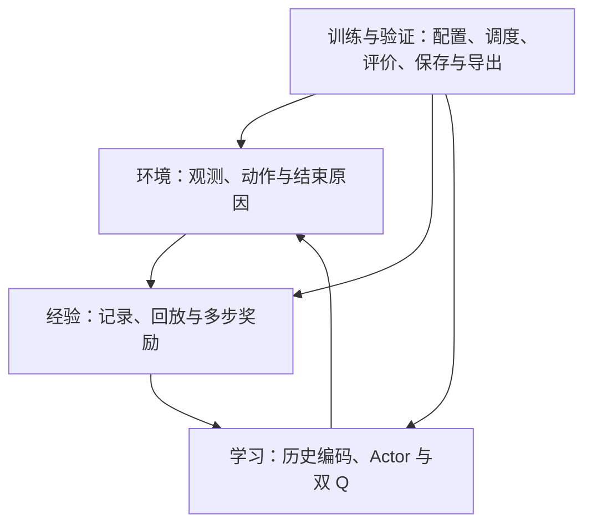

# study：TITA 从 PPO 迁移到 SAC

本项目的总目标是：理解并迁移 TITA 轮腿机器人的运动控制训练方法，把当前 PPO 主线改造为论文方法支持的 SAC，同时保留原 PPO 作为对照，让维护者能够解释、检查和修复每个模块。

**当前阶段：只建设仓库框架和全部 README。实现代码与测试程序由 Claude 后续逐模块完成。这里尚不是可运行的 SAC 工程，不能据此声称训练或性能验证已完成。**

## 两类读者，共用一份真实说明

- 人：先理解算法目的、物理含义和数据流，再按文件、函数阅读代码；关键公式和条件分支需要逐行解释。
- Claude 或其他 AI：把 README 当作任务规范，按输入输出、差异说明和验收规则实施，同时更新实际代码说明。

所有层级的 README 都承担这两种职责。计划文件/函数明确标为计划；代码存在后才写真实签名、链接与关键行说明。不能让文档描述一个实际不存在的功能。

## 第一次打开时怎样读

先读本页了解目标，再看四个大模块的职责表，最后从 E03 动作定义表进入第一个小模块。不要求一次读完 29 份说明。目录编号 E/D/N/T 分别对应环境、数据、网络、训练；编号用于文档导航，不是 Python 名称。

PPO 和 SAC 是两种改进控制策略的训练方法；策略是“看见状态后怎样产生动作”的规则。历史编码器把最近多帧观测整理成简短数字描述。Barlow Twins（简称 BT）是一种辅助学习目标，让相邻历史提取出一致、又不全都重复的特征。本项目先保留这部分，再更换策略训练方式。

## 四个大模块

| 大模块 | 职责 | 平级小模块数量 |
|---|---|---:|
| [环境与动作接口](environment_control/README.md) | 负责机器人任务、观测与动作的物理含义，以及一轮结束前后的数据。 | 5 |
| [经验与回报](experience_returns/README.md) | 把真实交互整理成可重复学习、时间关系正确的数据，并构造多步奖励部分。 | 5 |
| [网络与学习](networks_learning/README.md) | 解释状态、生成动作、评价动作，并依据不同学习目标更新对应参数。 | 8 |
| [训练与验证](training_validation/README.md) | 组织配置、采集和更新，保存进度，评价并导出模型，记录可复查证据。 | 6 |

```text
environment_control/
  README.md
  robot_environment/README.md
  observation_interface/README.md
  action_contract/README.md
  action_bounds/README.md
  episode_lifecycle/README.md
experience_returns/
  README.md
  transition_schema/README.md
  replay_buffer/README.md
  n_step_returns/README.md
  normalization/README.md
  history_windows/README.md
networks_learning/
  README.md
  history_encoder/README.md
  auxiliary_learning/README.md
  actor_distribution/README.md
  q_networks/README.md
  critic_learning/README.md
  actor_learning/README.md
  entropy_temperature/README.md
  target_updates/README.md
training_validation/
  README.md
  configuration/README.md
  training_loop/README.md
  checkpoints/README.md
  evaluation/README.md
  export_inference/README.md
  verification/README.md
```

各小模块内部最终采用“README + 实现文件 + 验证文件”的组织方式。根目录允许少量工程配置与 AI 阅读入口，不另建第五个业务大模块。当前没有创建空的 Python 文件冒充实现。

## 整体算法关系



Actor 是产生动作的网络；Q 是评价“状态＋动作”的网络；经验回放是保存并重复使用真实交互；目标 Q 是缓慢跟随更新的参考网络。SAC 的熵目标鼓励保留动作多样性，它不等于动作越激烈越好。

第一版保留 TITA 模型、底层控制、任务指令和奖励作为比较基础。历史编码、速度监督和 Barlow Twins 保留主要功能，SAC 替换动作分布、价值学习、策略更新和经历使用方式。TITA 没有启用实际 cost 约束项，原框架名为 NP3O，运动学习主线按 PPO 加辅助学习理解。

## 原版 PPO、论文与来源

- [固定原版 PPO 分支](https://github.com/kissmvp8-afk/study/tree/baseline/ppo)：本仓库快照提交 `8fe40aa0ab3afdb8998cab1357f1f795d2cabc3c`。
- 上游 [DDTRobot/DDT_Lab 固定提交](https://github.com/DDTRobot/DDT_Lab/tree/701a49c6e78dfb93a8b30145f0e7723b22921c0b)：`701a49c6e78dfb93a8b30145f0e7723b22921c0b`。
- 基线 80 个文件逐个内容一致，Git 树为 `88bb121c956f8704302cc5fdfae10e614b77c634`。这是快照归档，不是复制上游完整提交历史；原版权和许可标识一并保留。固定基线分支不用于开发或合并到新框架主线。
- 论文：[Bridging the Gap: Enabling Soft Actor Critic for High Performance Legged Locomotion](https://arxiv.org/abs/2605.24975)。
- 作者 [RSL-RL-SAC 固定提交](https://github.com/leggedrobotics/rsl_rl_sac/tree/e0d243aa6d3f8a7231783b7f3cefeaec1b4a5521)：`e0d243aa6d3f8a7231783b7f3cefeaec1b4a5521`。实现前按其来源保留许可说明，并记录本项目的改动。
- [UPSTREAM.json](UPSTREAM.json) 保存机器可读的版本依据。机器人资产仍来自外部 ddt_ros2_control，首次运行前需要锁定该资源版本。

论文四项重点是物理动作边界、温和的策略初始化、正确的时间截断处理和多步回报。轮速边界、历史编码保留方式和独立辅助学习调度属于本项目的 TITA 适配，不能描述成作者已验证过的 TITA 结果。

## 所有模块共同遵守的数据约定

| 数据或行为 | 约定 |
|---|---|
| 策略输入 | 每帧 33 个数，环境提供包含当前帧的 10 帧历史；从旧到新排列 |
| 历史编码 | 决策窗口 t-4..t；BT 的另一窗口 t-5..t-1，两者共用 6 个时刻 |
| Actor 输入 | 当前 33 维观测＋速度估计 3 维＋隐藏特征 16 维，共 52 维 |
| 速度监督 | 真实身体线速度使用原观测配置的 2.0 缩放；预测与标签一致 |
| 动作 | 8 维；索引 0,1,2,4,5,6 是角度，3,7 是轮速；具体名称见 E03 |
| 物理换算 | 腿部 q*=q0+0.25a；轮速 w*=5a；存入 Q 的动作与送入环境的策略动作同坐标 |
| 周期 | 策略 0.02 秒，物理步 0.005 秒；第一版保持一致 |
| 奖励 | 存环境实际奖励，SAC 存储路径不预加旧价值补偿 |
| 结束 | 真终止优先；纯时间截断用重置前末状态估值，不拼接新一轮奖励 |
| Q 输入 | 保留原训练侧额外信息，维数按运行时字段校验，不泄漏给 Actor |
| 统计 | 新数据更新输入统计，回放/推理使用统计，统计计数随检查点保存 |

## 实施顺序与阶段边界

1. 当前阶段：完成全部 README、AI 阅读入口、原版归档和文档一致性检查。
2. 先由 Claude 实施 [E03 八维动作定义表](environment_control/action_contract/README.md)，它可用原配置和人工元数据验证；再完成 E04 边界及 D01 数据记录。
3. 实施 D02/D03 经验与回报的纯数据检查；并行准备 T01 依赖与 E01/E02/E05 实际环境接入。依赖链接表示需理解契约，不代表假数据检查必须等待仿真安装。
4. 实施历史与归一化，再接网络及各独立学习目标，检查参数更新分工。
5. 接通训练循环，完成小规模仿真，再进行平地对照、复杂地形对照和导出一致性验证。

基线依赖涉及 Isaac Sim 5.1、Isaac Lab 2.3.0、Python 3.11，以及 PyTorch、RSL-RL。框架编写环境未安装这些训练依赖，也没有已确认的 GPU 训练能力。README 检查可以先进行，机器人训练必须在具备依赖与 GPU 的环境中验证。

## Claude 每次接手一个小模块的工作流程

1. 读 [CLAUDE.md](CLAUDE.md)，再读本文件 → 大模块 README → 当前小模块 README → 依赖的契约。
2. 明确此次输入、输出、改动范围和验证案例。已有授权范围内的必要关联修改说明影响后完成；需求或物理语义不明确时询问，不凭空猜测。
3. 将实现和验证放在小模块目录，保持单一职责。一次工作尽量产生一个可检查、可回退的改动。
4. 运行与改动相关的检查。测试程序应验证行为、边界和历史故障，而不是复制实现证明自己。
5. 同步 README 的真实文件/函数说明、关键代码逐行解释、可复制命令、实际结果与未验证事项。
6. 提交修改记录，说明“为什么改、改了什么、证据是什么、失败时从哪里查”。不把训练损失降低直接写成机器人性能提高。

## 每份小模块 README 的固定职责

人阅读部分：目的与术语 → 与 PPO 的关系 → 输入输出 → 文件及逐函数职责 → 关键计算解释 → 故障定位。

AI 执行部分：固定来源 → 依赖契约 → 实施顺序 → 不可破坏的规则 → 验收案例 → 状态与修改记录。

实现后必须把计划名称替换为实际名称并建立相对文件链接。关键行说明解释其原因与错误后果，普通语法不做机械重复。任何字段、单位、算法假设或函数行为改变，都要检查对应说明是否过期。

## 状态和验收证据

| 状态 | 必须具备的证据 |
|---|---|
| 待实现 | README 设计与验收案例；不得声称有实现 |
| 实现中 | 实际代码和剩余问题，尚未通过的检查清楚列出 |
| 单元验证通过 | 可复制命令、运行环境、测试结果与真实函数说明 |
| 集成验证通过 | 多模块连接后的真实仿真或约定集成证据；纯函数模块注明适用范围 |
| 性能验证完成 | 固定对照条件、重复训练和评价结果；与前几级状态分开记录 |

对照指标包括速度误差、摔倒率、稳定时长、动作与力矩表现、训练时间和内存。阈值应在原 PPO 基线数据取得后、正式 SAC 比较前确定。原导出历史拼接有静态不一致需要单独处理，见 T05；基线仿真评价与导出问题分开记录。

本次交付只声明框架、说明、来源和链接的核对；不声明 SAC 已实现、测试通过、训练完成或优于 PPO。
