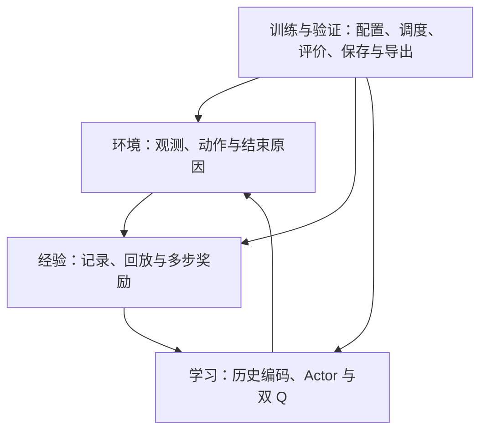

# study：TITA PPO → SAC｜AI 实施总规范

本项目把 TITA 轮腿机器人的运动控制训练主线从 PPO 迁移到论文支持的 SAC，并保留原 PPO 作为固定对照。本文件规定编程 AI 的实现范围、数据契约、注释要求和验收证据。

**当前交付框架与 AI 规范，以及 E03、E04 两个环境小模块、“经验与回报”D01～D05 与“网络与学习”N01～N08 的纯数据 / CPU 实现与单元验证（无仿真、无训练；使用人工数据；D、N 模块需要 PyTorch）；其余算法代码、代码注释和验证程序待 Claude 实现，人类讲解由 Codex 基于实际代码编写初稿，再由 Gemini 润色表达。SAC 尚不可运行，也没有训练或性能验证结果。**

人类阅读入口：[README_HUMAN.md](README_HUMAN.md)（等待代码完成）。

## 两套文档与分工

每个层级都有两个并列文件，共 29 对、58 份 README 文件：根目录一对，四个大模块各一对，24 个小模块各一对。

| 文件或内容 | 负责者 | 内容与用途 |
|---|---|---|
| `README.md` | 本轮由 Codex 建立；实施时由 Claude 同步维护 | 实现规范、算法差异、输入输出、文件与函数职责、约束和验收证据 |
| `README_HUMAN.md` | Codex 技术初稿 → Gemini 语言润色 | 同一份面向零 Python 基础的讲解；Codex 核对真实代码并逐文件/函数解释，Gemini 改善表达 |
| 实现与验证代码、代码内注释 | Claude | 按 AI 规范实现，注释说明原因、单位、边界与容易写错的行为 |
| [CLAUDE.md](CLAUDE.md) / [AGENTS.md](AGENTS.md) | 编程 AI 阅读入口 | 引导读取同一套规范，避免规则分叉 |
| [CODEX.md](CODEX.md) | Codex 技术初稿入口 | 实际代码阅读、逐文件/函数讲解、关键行解释和技术核对 |
| [GEMINI.md](GEMINI.md) | Gemini 语言润色入口 | 让表达自然易懂，保留技术含义、代码引用与验证结论 |

E03、E04、D01 人类版已完成讲解与润色；D02～D05 及“经验与回报”大模块人类版讲解与技术复核已完成，本轮不再润色；N01～N08 及“网络与学习”大模块九份人类版讲解与技术复核已完成，本轮不再另交 Gemini；其余 12 份只有状态与导航、等待代码完成。顺序固定为：AI 实施规范 → Claude 完成代码、注释与验证记录 → Codex 阅读实际代码并编写技术初稿 → Gemini 润色同一份人类版。两者都不在代码完成前撰写教学内容，也不新增第三套 README。

按文档覆盖范围交接：小模块代码完成后可编写该小模块的人类版；大模块人类版等待其涵盖的小模块代码与接口完成；根目录人类版等待四个大模块的代码与接口完成。仅有计划文件、空函数或无法读取代码，不满足写作条件。验证记录可以包含失败或尚未执行的项目，必须如实说明；开始讲解不代表全部仿真与性能检查已通过。

## 编程 AI 的阅读顺序

读取 CLAUDE.md/AGENTS.md → 本文件 → 目标大模块 README.md → 目标小模块 README.md → 依赖模块的契约与固定来源。E/D/N/T 是模块编号，分别代表环境、数据、网络、训练。每次实施限定到明确的小模块及必要关联修改。

人类版不是新的算法规范。规范、代码和讲解不一致时，先记录具体冲突：规范描述预期行为，代码体现当前行为，测试提供证据；不能为了让文字一致而隐瞒实现偏差。

## 四个大模块

| 大模块 | 职责 | 平级小模块数量 |
|---|---|---:|
| [环境与动作接口](environment_control/README.md) | 负责机器人任务、观测与动作的物理含义，以及一轮结束前后的数据。 | 5 |
| [经验与回报](experience_returns/README.md) | 把真实交互整理成可重复学习、时间关系正确的数据，并构造多步奖励部分。 | 5 |
| [网络与学习](networks_learning/README.md) | 解释状态、生成动作、评价动作，并依据不同学习目标更新对应参数。 | 8 |
| [训练与验证](training_validation/README.md) | 组织配置、采集和更新，保存进度，评价并导出模型，记录可复查证据。 | 6 |

```text
environment_control/
  README.md + README_HUMAN.md
  robot_environment/{README.md, README_HUMAN.md}
  observation_interface/{README.md, README_HUMAN.md}
  action_contract/{README.md, README_HUMAN.md}
  action_bounds/{README.md, README_HUMAN.md}
  episode_lifecycle/{README.md, README_HUMAN.md}
experience_returns/
  README.md + README_HUMAN.md
  transition_schema/{README.md, README_HUMAN.md}
  replay_buffer/{README.md, README_HUMAN.md}
  n_step_returns/{README.md, README_HUMAN.md}
  normalization/{README.md, README_HUMAN.md}
  history_windows/{README.md, README_HUMAN.md}
networks_learning/
  README.md + README_HUMAN.md
  history_encoder/{README.md, README_HUMAN.md}
  auxiliary_learning/{README.md, README_HUMAN.md}
  actor_distribution/{README.md, README_HUMAN.md}
  q_networks/{README.md, README_HUMAN.md}
  critic_learning/{README.md, README_HUMAN.md}
  actor_learning/{README.md, README_HUMAN.md}
  entropy_temperature/{README.md, README_HUMAN.md}
  target_updates/{README.md, README_HUMAN.md}
training_validation/
  README.md + README_HUMAN.md
  configuration/{README.md, README_HUMAN.md}
  training_loop/{README.md, README_HUMAN.md}
  checkpoints/{README.md, README_HUMAN.md}
  evaluation/{README.md, README_HUMAN.md}
  export_inference/{README.md, README_HUMAN.md}
  verification/{README.md, README_HUMAN.md}
```

各小模块内部最终采用“AI 版 README + 人类版 README + 实现文件 + 验证文件”的组织方式。根目录允许少量工程配置与 AI 阅读入口，不另建第五个业务大模块。当前没有创建空的 Python 文件冒充实现。

## 整体算法关系



Actor 是产生动作的网络；Q 是评价“状态＋动作”的网络；经验回放是保存并重复使用真实交互；目标 Q 是缓慢跟随更新的参考网络。SAC 的熵目标鼓励保留动作多样性，它不等于动作越激烈越好。

第一版保留 TITA 模型、底层控制、任务指令和奖励作为比较基础。历史编码、速度监督和 Barlow Twins 保留主要功能，SAC 替换动作分布、价值学习、策略更新和经历使用方式。TITA 没有启用实际 cost 约束项，原框架名为 NP3O，运动学习主线按 PPO 加辅助学习理解。

## 原版 PPO、论文与来源

- [固定原版 PPO 分支](https://github.com/kissmvp8-afk/study/tree/baseline/ppo)：本仓库快照提交 `8fe40aa0ab3afdb8998cab1357f1f795d2cabc3c`。
- 上游 [DDTRobot/DDT_Lab 固定提交](https://github.com/DDTRobot/DDT_Lab/tree/701a49c6e78dfb93a8b30145f0e7723b22921c0b)：`701a49c6e78dfb93a8b30145f0e7723b22921c0b`。
- 基线 80 个文件逐个内容一致，Git 树为 `88bb121c956f8704302cc5fdfae10e614b77c634`。这是快照归档，不是复制上游完整提交历史；原版权和许可标识一并保留。固定基线分支不用于开发或合并到新框架主线。
- 论文：[Bridging the Gap: Enabling Soft Actor Critic for High Performance Legged Locomotion](https://arxiv.org/abs/2605.24975)。
- 作者 [RSL-RL-SAC 固定提交](https://github.com/leggedrobotics/rsl_rl_sac/tree/e0d243aa6d3f8a7231783b7f3cefeaec1b4a5521)：`e0d243aa6d3f8a7231783b7f3cefeaec1b4a5521`。实现前按其来源保留许可说明，并记录本项目的改动。
- [UPSTREAM.json](UPSTREAM.json) 保存机器可读的版本依据。机器人资产仍来自外部 ddt_ros2_control，首次运行前需要锁定该资源版本。

论文四项重点是物理动作边界、温和的策略初始化、正确的时间截断处理和多步回报。轮速边界、历史编码保留方式和独立辅助学习调度属于本项目的 TITA 适配，不能描述成作者已验证过的 TITA 结果。

## 所有模块共同遵守的数据约定

| 数据或行为 | 约定 |
|---|---|
| 策略输入 | 每帧 33 个数，环境提供包含当前帧的 10 帧历史；从旧到新排列 |
| 历史编码 | 决策窗口 t-4..t；BT 的另一窗口 t-5..t-1，两者共用 6 个时刻 |
| Actor 输入 | 当前 33 维观测＋速度估计 3 维＋隐藏特征 16 维，共 52 维 |
| 速度监督 | 真实身体线速度使用原观测配置的 2.0 缩放；预测与标签一致 |
| 动作 | 8 维；索引 0,1,2,4,5,6 是角度，3,7 是轮速；具体名称见 E03 |
| 物理换算 | 腿部 q*=q0+0.25a；轮速 w*=5a；存入 Q 的动作与送入环境的策略动作同坐标 |
| 周期 | 策略 0.02 秒，物理步 0.005 秒；第一版保持一致 |
| 奖励 | 存环境实际奖励，SAC 存储路径不预加旧价值补偿 |
| 结束 | 真终止优先；纯时间截断用重置前末状态估值，不拼接新一轮奖励 |
| Q 输入 | 保留原训练侧额外信息，维数按运行时字段校验，不泄漏给 Actor |
| 统计 | 新数据更新输入统计，回放/推理使用统计，统计计数随检查点保存 |

## 实施顺序与阶段边界

1. 已完成：29 份 AI 实施规范、29 个人类版占位文件、Claude/Codex/Gemini 入口、原版归档和文档一致性检查。
2. 已完成 [E03 八维动作定义表](environment_control/action_contract/README.md)（实现、单元验证、人类版讲解与润色）和 [E04 动作边界与初始中心](environment_control/action_bounds/README.md)（实现、单元验证、人类版讲解与润色）；[经验与回报](experience_returns/README.md) 的 D01～D05 已完成实现与单元验证（需要 PyTorch）；其中 D01 人类版已完成讲解与润色，D02～D05 与大模块人类版讲解与技术复核已完成，本轮不再润色；[网络与学习](networks_learning/README.md) 的 N01～N08 已完成 CPU 实现与单元验证（含一次完整更新衔接检查），八份小模块及大模块人类版讲解与技术复核已完成，本轮不再另交 Gemini。
3. 实施 D02/D03 经验与回报的纯数据检查；并行准备 T01 依赖与 E01/E02/E05 实际环境接入。依赖链接表示需理解契约，不代表假数据检查必须等待仿真安装。
4. 实施历史与归一化，再接网络及各独立学习目标，检查参数更新分工。
5. 接通训练循环，完成小规模仿真，再进行平地对照、复杂地形对照和导出一致性验证。

基线依赖涉及 Isaac Sim 5.1、Isaac Lab 2.3.0、Python 3.11，以及 PyTorch、RSL-RL。框架编写环境未安装这些训练依赖，也没有已确认的 GPU 训练能力。README 检查可以先进行，机器人训练必须在具备依赖与 GPU 的环境中验证。

## 代码注释规范

Claude 实现时必须把注释放进实际代码，README 中的解释不能替代代码注释。默认使用简体中文解释，保留准确的变量名、函数名、公式和来源许可标识。

1. 每个实现文件开头写模块说明：职责、不负责的事情、上游输入、下游输出，以及与原 PPO/作者 SAC 的关系。
2. 每个自定义类、函数和方法写 docstring（定义处的说明文字）：用途、关键参数、返回值、异常与副作用。涉及数组时写清形状、轴顺序、数据类型、物理单位与坐标；涉及训练时写清哪些参数或统计会改变。简单函数可简短写，不省略关键契约。
3. 在关键公式和分支附近解释“为什么需要、前提是什么、删错会怎样”：动作映射、历史切片、终止与截断、多步折扣、密度修正、梯度隔离、目标更新及保存恢复。
4. 标明数值常量来源、稳定计算的处理与适用范围；说明复制/共享存储、原地修改、随机性及统计更新的时机。不要把暂定超参数写成已验证最优值。
5. 注释与代码同次修改；不写重复语法的无效注释，不给每一行机械加说明，不编造函数、结论或行号。关键代码的逐行教学由 Codex 写在人类版，再由 Gemini 润色表达。
6. 验证代码也说明案例意图、预期结果的独立依据及它能捕捉的错误。合并前抽查关键分支的注释是否与实现和验证一致；不能仅检查注释数量。

下面仅示范注释风格，不是已实现的 API：

```text
不合格：计算下一状态。
合格：纯时间截断仍允许估计后续价值，因此使用重置前的末状态；若使用重置后状态，会把新一轮的价值接到上一轮。
```

各小模块还列出自己的注释重点。即使 Codex 尚未开始写作，Claude 也必须交付清楚的代码注释。

## Claude 的实施与交接流程

1. 读取规范和来源，说明本次输入、输出、改动范围及验收案例；缺少物理语义时明确询问，不猜测配置。
2. 在所属小模块实现代码、docstring、关键注释与验证。实现和验证文件仍与两份 README 并列。
3. 运行适用检查；记录实际命令、环境、结果和未执行项。没有仿真条件时只声明已完成的文档或纯数据检查。
4. 更新本模块 README.md 的真实文件链接、函数签名、职责、单位、异常、副作用和证据；更新受影响的依赖契约与父模块状态。
5. 完成本模块“实现证据与文档交接”表，列出实际代码/测试文件、关键函数、变更原因和待解释计算。暂未提交时写未提交并列出改动文件；提交后填写可核对的代码提交号。
6. 维护人类版状态：代码未完成时保持“等待代码完成”；首次完成代码、注释和验证记录后标为“待 Codex 编写”；已有讲解受代码变更影响时标为“待 Codex 同步”。只更新元数据并保留已有正文，不代写教学内容。
7. 确认讲解范围内的代码已完成后，将同一版本的实际代码、注释、规范、验证记录和变更清单交给 Codex，按 CODEX.md 编写或更新人类版技术初稿。
8. Codex 核对初稿与代码后标为“待 Gemini 润色”；用户将初稿、所对应代码版本及技术依据交给 Gemini，按 GEMINI.md 润色同一文件。润色不得改变符号、公式、单位、关键条件或验证结论。代码变更后先回到 Codex 技术同步，再润色。

## 每份 AI 版 README 的内容要求

保留目的、固定来源、PPO→SAC 差异、输入输出、文件与逐函数职责、算法约束、注释重点、验收案例、排错线索和状态证据。计划文件/函数明确标为计划；实现后替换成真实接口与相对链接。AI 版负责可实施的规范，不复制人类版的完整教学正文。

实际接口记录至少包括：文件和符号名、参数/返回值、形状与单位、可能的异常、副作用或梯度边界、调用方，以及验证案例。公共契约修改必须同步所有受影响模块。

人类版另有独立状态：等待代码完成、待 Codex 编写、待 Gemini 润色、待 Codex 同步、已完成讲解与润色。另记技术核对状态、语言润色状态及已核对代码版本：Codex 负责技术核对，Gemini 只更新润色记录，不替代或虚构代码核对结果。流程完成不代表算法训练成功。

## 状态和验收证据

| 状态 | 必须具备的证据 |
|---|---|
| 待实现 | README 设计与验收案例；不得声称有实现 |
| 实现中 | 实际代码和剩余问题，尚未通过的检查清楚列出 |
| 单元验证通过 | 可复制命令、运行环境、测试结果与真实函数说明 |
| 集成验证通过 | 多模块连接后的真实仿真或约定集成证据；纯函数模块注明适用范围 |
| 性能验证完成 | 固定对照条件、重复训练和评价结果；与前几级状态分开记录 |

对照指标包括速度误差、摔倒率、稳定时长、动作与力矩表现、训练时间和内存。阈值应在原 PPO 基线数据取得后、正式 SAC 比较前确定。原导出历史拼接有静态不一致需要单独处理，见 T05；基线仿真评价与导出问题分开记录。

本次交付只声明框架、说明、来源和链接的核对；不声明 SAC 已实现、测试通过、训练完成或优于 PPO。
