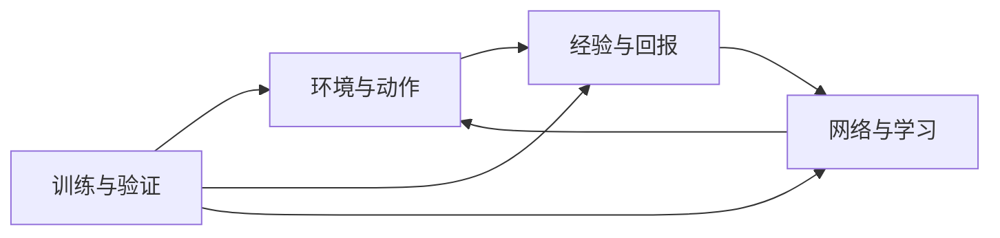

# study：TITA PPO → SAC

TITA 轮腿机器人的 SAC 学习实现与中文代码讲解。项目保留原 PPO 固定快照，用四个大模块组织环境接口、经验回放、网络学习和训练验证。

**第一次阅读：**[项目讲解与数据流](README_HUMAN.md) · [安装与仿真入口](environment_control/robot_environment/README.md#windows--nvidia-安装与验证步骤powershell) · [AI 维护规则](AGENTS.md)

## 当前状态

- 四大模块、24 个小模块已有实现、测试和人类讲解。已入库的实现阶段记录包括 216 项 CPU 单元检查（其中一次跳过真实资产检查 1 项）和 18 项 CPU 集成检查，具体版本与环境见各模块证据表。
- 2026-11-01 用户回传的后续 Windows 实验已跑通平地单环境的加载、交互、训练、保存恢复与评价；累计 5000 轮及后续奖励 A/B 实验仍未证明可靠的前进、后退和停走控制，也没有 SAC 优于 PPO 的结论。
- 上一条是仓库外实验回报的摘要，不是本次文档清理重新运行的结果。Windows 路径修复和超时诊断见 [PR #9](https://github.com/kissmvp8-afk/study/pull/9)，后续完整训练证据尚未归入本主线；不要把仓库外实验结果当作当前检出版本的完整验收。
- 正式奖励配置保留原值；线速度跟踪权重 8 仅为实验候选。工作轮速 20 rad/s 也是调试选择。复杂地形、长期稳定行走、多训练种子对照和性能仍待验证。

## 从哪里读

人类讲解面向有 Python 基础的读者；接口规范供修改代码时查阅。每个目录只保留一份 `README_HUMAN.md`，两类文档相互链接，不再设置 Gemini 润色流程。

| 大模块 | 代码范围 | 人类讲解 | 接口规范 |
|---|---|---|---|
| 环境与动作接口 | E01～E05：任务、观测、动作、边界、回合结束 | [阅读](environment_control/README_HUMAN.md) | [查接口](environment_control/README.md) |
| 经验与回报 | D01～D05：记录、回放、多步回报、归一化、历史 | [阅读](experience_returns/README_HUMAN.md) | [查接口](experience_returns/README.md) |
| 网络与学习 | N01～N08：编码、辅助学习、Actor、Q、损失、温度、慢更新 | [阅读](networks_learning/README_HUMAN.md) | [查接口](networks_learning/README.md) |
| 训练与验证 | T01～T06：配置、调度、检查点、评价、导出、检查 | [阅读](training_validation/README_HUMAN.md) | [查接口](training_validation/README.md) |

理解算法先看 E03/E04 → D01～D05 → N01～N08 → T02；准备运行先看 E01 → T01 → T02/T03。模块内的代码、测试和两份 README 放在一起。



## 运行与检查

用 Git 克隆以保留固定 PPO 快照，E03 会通过 `git show` 读取它；只下载主分支 ZIP 不包含这一对象。

```bash
git clone https://github.com/kissmvp8-afk/study.git
cd study
python -B training_validation/verification/verify.py --docs
```

文档检查只用 Python 标准库。纯数据动作检查也无需 Isaac：

```bash
python -B environment_control/action_contract/test_contract.py -v
python -B environment_control/action_bounds/test_bounds.py -v
```

其余 CPU 检查需要 PyTorch。使用已配置好依赖的解释器，在仓库根目录运行：

```bash
python -B training_validation/verification/verify.py --unit --integration
```

真实仿真使用 Python 3.11、Isaac Sim 5.1.0、Isaac Lab v2.3.0 和锁定的 DDT/资产版本；安装与 `inspect/interact/train` 参数集中见 [E01](environment_control/robot_environment/README.md#windows--nvidia-安装与验证步骤powershell)。学习器目前在 CPU 上，仿真可使用 NVIDIA GPU。T06 的仿真/性能项为 `not_run`，它不会自动运行或导入外部实验。

## 所有模块共同遵守的数据约定

| 数据或行为 | 约定 |
|---|---|
| 策略输入 | 每帧 33 个数，环境提供包含当前帧的 10 帧历史；从旧到新排列 |
| 历史编码 | 决策窗口 t-4..t；BT 的另一窗口 t-5..t-1，两者共用 6 个时刻 |
| Actor 输入 | 当前 33 维观测＋速度估计 3 维＋隐藏特征 16 维，共 52 维 |
| 速度监督 | 真实身体线速度使用原观测配置的 2.0 缩放；预测与标签一致 |
| 动作 | 8 维；索引 0,1,2,4,5,6 是角度，3,7 是轮速；具体名称见 E03 |
| 物理换算 | 腿部 q*=q0+0.25a；轮速 w*=5a；存入 Q 的动作与送入环境的策略动作同坐标 |
| 周期 | 策略 0.02 秒，物理步 0.005 秒；第一版保持一致 |
| 奖励 | 存环境实际奖励，SAC 存储路径不预加旧价值补偿 |
| 结束 | 真终止优先；纯时间截断用重置前末状态估值，不拼接新一轮奖励 |
| Q 输入 | 保留原训练侧额外信息，维数按运行时字段校验，不泄漏给 Actor |
| 统计 | 新数据更新输入统计，回放/推理使用统计，统计计数随检查点保存 |

## 原版 PPO、论文与来源

- [固定原版 PPO 分支](https://github.com/kissmvp8-afk/study/tree/baseline/ppo)：本仓库快照提交 `8fe40aa0ab3afdb8998cab1357f1f795d2cabc3c`。
- 上游 [DDTRobot/DDT_Lab 固定提交](https://github.com/DDTRobot/DDT_Lab/tree/701a49c6e78dfb93a8b30145f0e7723b22921c0b)：`701a49c6e78dfb93a8b30145f0e7723b22921c0b`。
- 基线 80 个文件逐个内容一致，Git 树为 `88bb121c956f8704302cc5fdfae10e614b77c634`。这是快照归档，不是复制上游完整提交历史；原版权和许可标识一并保留。固定基线分支不用于开发或合并到新框架主线。
- 论文：[Bridging the Gap: Enabling Soft Actor Critic for High Performance Legged Locomotion](https://arxiv.org/abs/2605.24975)。
- 作者 [RSL-RL-SAC 固定提交](https://github.com/leggedrobotics/rsl_rl_sac/tree/e0d243aa6d3f8a7231783b7f3cefeaec1b4a5521)：`e0d243aa6d3f8a7231783b7f3cefeaec1b4a5521`。保留其来源与许可说明，并记录本项目的改动。
- [UPSTREAM.json](UPSTREAM.json) 保存机器可读的版本依据。机器人资产来自外部 ddt_ros2_control，已锁定提交 e7b32d9（URDF 路径与 SHA-256 记录在 UPSTREAM.json，本仓库不复制文件）。

论文四项重点是物理动作边界、温和的策略初始化、正确的时间截断处理和多步回报。轮速边界、历史编码保留方式和独立辅助学习调度属于本项目的 TITA 适配，不能描述成作者已验证过的 TITA 结果。

## 代码注释规范

代码、注释、验证和文档同步统一遵循 [AGENTS.md](AGENTS.md#代码与验证)。Claude 入口见 [CLAUDE.md](CLAUDE.md)，Codex 审核与人类讲解要求见 [CODEX.md](CODEX.md)。
