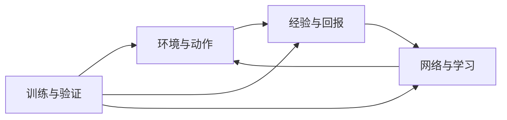

# study：TITA PPO → SAC

TITA 轮腿机器人的 SAC 学习实现与中文代码讲解。读者可以直接阅读代码和人类讲解，也可以让自己的 AI 根据接口规范检查、复现或继续开发。

## 我们完成了什么

我们以原 PPO 项目的机器人资产、仿真任务、观测/动作配置及奖励为基础，搭建了 SAC 训练系统，并保留原 PPO 固定快照供核对。工作分成四个大模块、24 个小模块：

- 明确八维混合动作的物理含义、边界和初始中心，处理观测历史与重置前末状态。
- 实现经验回放、多步回报、输入归一化，以及带历史编码和辅助学习的 SAC Actor、双 Q、温度更新。
- 接通采集、学习、检查点保存恢复、评价和导出，并提供模块测试、中文接口规范和代码讲解。

**目前已完成 SAC 框架迁移与平地单环境运行验证；可靠的前进、后退、停走和速度跟踪仍待改进，尚不能宣称机器人已学会行走或 SAC 优于 PPO。**

**第一次阅读：**[项目讲解与数据流](README_HUMAN.md) · [安装与仿真入口](environment_control/robot_environment/README.md#windows--nvidia-安装与验证步骤powershell) · [项目维护规则](#项目维护规则) · [成果验证方法](#运行与检查)

## 当前状态

- 四大模块、24 个小模块已有实现、测试和人类讲解。已入库的实现阶段记录包括 216 项 CPU 单元检查（其中一次跳过真实资产检查 1 项）和 18 项 CPU 集成检查，具体版本与环境见各模块证据表。
- [PR #9](https://github.com/kissmvp8-afk/study/pull/9) 已合并：Windows 报告路径修复，以及平地单环境加载、交互、短训练保存恢复和真实纯时间截断的[报告、命令与证据](environment_control/robot_environment/validation/windows_2026-10-31/REPORT.md)已入库。截断诊断提前设置计数器，只推进 0.04 秒，不证明稳定运行满 20 秒。
- 2026-11-01 用户回传的后续实验包括累计 5000 轮训练及奖励 A/B 对照；完整证据尚未归入本主线。它们仍未证明可靠的前进、后退和停走控制，也没有 SAC 优于 PPO 的结论；这段摘要不是本次文档清理重新运行的结果。
- 正式奖励配置保留原值；线速度跟踪权重 8 仅为实验候选。工作轮速 20 rad/s 也是调试选择。复杂地形、长期稳定行走、多训练种子对照和性能仍待验证。

## 从哪里读

人类讲解面向有 Python 基础的读者；AI 版记录接口、约束和验证依据。每个目录只保留一份 `README_HUMAN.md`，修改代码的人或 AI 同时维护两份说明。AI 先读本页维护规则，再按任务读取模块文档和源码。

| 大模块 | 代码范围 | 人类讲解 | 接口规范 |
|---|---|---|---|
| 环境与动作接口 | E01～E05：任务、观测、动作、边界、回合结束 | [阅读](environment_control/README_HUMAN.md) | [查接口](environment_control/README.md) |
| 经验与回报 | D01～D05：记录、回放、多步回报、归一化、历史 | [阅读](experience_returns/README_HUMAN.md) | [查接口](experience_returns/README.md) |
| 网络与学习 | N01～N08：编码、辅助学习、Actor、Q、损失、温度、慢更新 | [阅读](networks_learning/README_HUMAN.md) | [查接口](networks_learning/README.md) |
| 训练与验证 | T01～T06：配置、调度、检查点、评价、导出、检查 | [阅读](training_validation/README_HUMAN.md) | [查接口](training_validation/README.md) |

理解算法先看 E03/E04 → D01～D05 → N01～N08 → T02；准备运行先看 E01 → T01 → T02/T03。模块内的代码、测试和两份 README 放在一起。



## 运行与检查

### 1. 获取源码与固定基线

使用完整 Git 克隆，E03 会通过 `git show` 读取固定 PPO 快照。主分支 ZIP 或只获取 main 的浅克隆不足以完成这一检查。

```bash
git clone https://github.com/kissmvp8-afk/study.git
cd study
git rev-parse HEAD
git cat-file -t 8fe40aa0ab3afdb8998cab1357f1f795d2cabc3c
```

最后一条应输出 `commit`；若对象缺失，执行 `git fetch origin baseline/ppo` 后再检查。记录本次 HEAD、解释器与依赖版本，以便别人核对同一版结果。

### 2. 不安装 Isaac，先验证纯数据和 CPU 流程

Python 标准库即可执行文档与动作检查：

```bash
python -B training_validation/verification/verify.py --docs
python -B environment_control/action_contract/test_contract.py -v
python -B environment_control/action_bounds/test_bounds.py -v
```

预期文档层为 `passed`，E03/E04 分别运行 18/14 项并显示 `OK`；查看是否有因缺少快照而跳过的项目，不能将跳过算作已验证。

全仓 CPU 验证还需要 PyTorch，无需 NVIDIA 显卡。建议使用独立的 Python 3.11 虚拟环境：先运行 `python -m venv .venv`，Windows PowerShell 用 `.\.venv\Scripts\Activate.ps1` 激活，Linux/macOS 用 `source .venv/bin/activate` 激活，再执行：

```bash
python -m pip install torch==2.7.0
python -B training_validation/verification/verify.py --docs --unit --integration --json cpu-verification.json
```

已有 Isaac 环境则直接使用其锁定的解释器和依赖，不执行上面的 CPU 环境安装。检查 JSON 中 `documentation`、`unit`、`cpu_integration` 的状态、失败条目和跳过数，终端退出码应为 0。当前已入库记录为 216 项单元与 18 项 CPU 集成；未设置 `TITA_URDF` 时真实资产检查会跳过 1 项，设置方法见 [E01](environment_control/robot_environment/README.md#windows--nvidia-安装与验证步骤powershell)。`simulation/performance: not_run` 表示此入口未执行这两层。

CPU 结果证明给定案例中的计算和数据衔接符合断言；其中环境是人工数据或模拟钩子，不能代替真实仿真。

### 3. 使用 Windows + NVIDIA 验证真实最小流程

先按 [E01 安装说明](environment_control/robot_environment/README.md#windows--nvidia-安装与验证步骤powershell) 准备 Python 3.11、Isaac Sim 5.1.0、Isaac Lab v2.3.0、PyTorch 2.7.0+cu128 及锁定 DDT/资产版本。以下在已激活的 Isaac 环境、study 根目录运行；明确使用平地、1 个环境，学习器仍在 CPU 上：

```powershell
$kitArgs = '--kit_args=--vulkan --/app/extensions/fsWatcherEnabled=false'
python -B environment_control/robot_environment/run_sac_isaac.py --task isaac_flat --mode inspect --num_envs 1 --seed 0 --headless $kitArgs --output_dir runs/review-inspect
python -B environment_control/robot_environment/run_sac_isaac.py --task isaac_flat --mode interact --num_envs 1 --seed 0 --steps 50 --headless $kitArgs --output_dir runs/review-interact
python -B environment_control/robot_environment/run_sac_isaac.py --task isaac_flat --mode train --num_envs 1 --seed 0 --iterations 3 --steps_per_iteration 8 --capacity_per_env 200 --wheel_speed_limit 20 --headless $kitArgs --output_dir runs/review-train
```

最后一条包含“训练 → 保存 → 构造新 Trainer → 恢复 → 续训 1 轮”。20 rad/s 是本次示例沿用的调试轮速，不是经过验证的最优值。`interact` 使用默认腿目标和零轮速，只检查交互数据，不评价学到的策略；真终止后会正常重置。

查看每次的退出码、`metadata.json` 和 `summary.json`：加载时核对 8 维动作、平地 33 维策略帧 / 54 维 Q 观测和 0.02 s 控制周期；交互数据应有限；训练摘要应有学习记录、检查点与恢复续训结果。保存的是学习状态和经验池，恢复时仿真现场重新开始。运行命令、版本、已知图形告警及原始记录见 [Windows 验证报告](environment_control/robot_environment/validation/windows_2026-10-31/REPORT.md)。

如需单独复查纯时间截断路径，可运行：

```powershell
python -B environment_control/robot_environment/diagnose_timeout_isaac.py --seed 0 --max_attempts 1 --headless $kitArgs --output_dir runs/review-timeout
```

该诊断提前设置计数器，检查真实末状态、自举标记与重置后历史；它验证截断路径，不代表机器人自然稳定运行满 20 秒。普通交互即使执行 1005 步，也可能因为中途真终止而没有发生超时。

### 4. 怎样判断成果是否复现

| 想验证的结论 | 查看什么 | 能说明的范围 |
|---|---|---|
| 代码与接口可检查 | 模块源码、两份 README、CPU 检查报告 | 给定案例通过，模块能够衔接 |
| SAC 能在仿真中运行 | inspect/interact/train 的日志、元数据与保存恢复摘要 | 平地单环境最小训练流程可用 |
| 终止与截断处理正确 | 独立截断诊断及保存的末状态记录 | 本次实际触发的边界路径通过 |
| 机器人学会跟踪指令 | 独立评价中的速度误差、停走、方向、接触与终止情况 | 当前尚未充分成立，不能仅凭奖励或损失下降判断 |
| SAC 优于 PPO | 同任务、预算、多个独立训练种子的固定评价 | 当前尚无该结论 |

仓库没有提交训练权重；后续 5000 轮与奖励 A/B 的完整记录也尚未入库，因此仅克隆仓库不能复现那些特定检查点的评价数字。可以复查已入库证据或按上述入口独立运行；新的训练效果仍需按 [T04 评价规范](training_validation/evaluation/README.md)报告。提交验证结果时附源码提交号、实际命令、版本、任务/种子/规模、退出码及相关 JSON，并分别标明通过、失败、跳过和未执行。

## 所有模块共同遵守的数据约定

| 数据或行为 | 约定 |
|---|---|
| 策略输入 | 每帧 33 个数，环境提供包含当前帧的 10 帧历史；从旧到新排列 |
| 历史编码 | 决策窗口 t-4..t；BT 的另一窗口 t-5..t-1，两者共用 6 个时刻 |
| Actor 输入 | 当前 33 维观测＋速度估计 3 维＋隐藏特征 16 维，共 52 维 |
| 速度监督 | 真实身体线速度使用原观测配置的 2.0 缩放；预测与标签一致 |
| 动作 | 8 维；索引 0,1,2,4,5,6 是角度，3,7 是轮速；具体名称见 E03 |
| 物理换算 | 腿部 q*=q0+0.25a；轮速 w*=5a；存入 Q 的动作与送入环境的策略动作同坐标 |
| 周期 | 策略 0.02 秒，物理步 0.005 秒；第一版保持一致 |
| 奖励 | 存环境实际奖励，SAC 存储路径不预加旧价值补偿 |
| 结束 | 真终止优先；纯时间截断用重置前末状态估值，不拼接新一轮奖励 |
| Q 输入 | 保留原训练侧额外信息，维数按运行时字段校验，不泄漏给 Actor |
| 统计 | 新数据更新输入统计，回放/推理使用统计，统计计数随检查点保存 |

## 原版 PPO、论文与来源

- [固定原版 PPO 分支](https://github.com/kissmvp8-afk/study/tree/baseline/ppo)：本仓库快照提交 `8fe40aa0ab3afdb8998cab1357f1f795d2cabc3c`。
- 上游 [DDTRobot/DDT_Lab 固定提交](https://github.com/DDTRobot/DDT_Lab/tree/701a49c6e78dfb93a8b30145f0e7723b22921c0b)：`701a49c6e78dfb93a8b30145f0e7723b22921c0b`。
- 基线 80 个文件逐个内容一致，Git 树为 `88bb121c956f8704302cc5fdfae10e614b77c634`。这是快照归档，不是复制上游完整提交历史；原版权和许可标识一并保留。固定基线分支不用于开发或合并到新框架主线。
- 论文：[Bridging the Gap: Enabling Soft Actor Critic for High Performance Legged Locomotion](https://arxiv.org/abs/2605.24975)。
- 作者 [RSL-RL-SAC 固定提交](https://github.com/leggedrobotics/rsl_rl_sac/tree/e0d243aa6d3f8a7231783b7f3cefeaec1b4a5521)：`e0d243aa6d3f8a7231783b7f3cefeaec1b4a5521`。保留其来源与许可说明，并记录本项目的改动。
- [UPSTREAM.json](UPSTREAM.json) 保存机器可读的版本依据。机器人资产来自外部 ddt_ros2_control，已锁定提交 e7b32d9（URDF 路径与 SHA-256 记录在 UPSTREAM.json，本仓库不复制文件）。

论文四项重点是物理动作边界、温和的策略初始化、正确的时间截断处理和多步回报。轮速边界、历史编码保留方式和独立辅助学习调度属于本项目的 TITA 适配，不能描述成作者已验证过的 TITA 结果。

## 项目维护规则

本节是人类维护者和所有 AI 共用的维护规则；`AGENTS.md` 只提供入口。历史记录中的 Claude、Codex、Gemini 署名说明当时的工作，不再构成角色分工要求。

1. **谁修改代码，谁同步说明。修改任何小模块代码时，必须在同一改动（同一 PR 或提交）中更新该目录的 `README.md` 和 `README_HUMAN.md`，不能只改代码或留下“待另一个 AI 编写”。**
2. AI 版写清实际接口、形状、单位、顺序、异常/副作用、调用关系和验证依据；人类版面向有 Python 基础的读者，说明解决什么问题、数据如何流动、关键计算为什么这样写及如何验证和排错。依据实际源码更新受影响部分，不复制整份接口表或逐行翻译语法。
3. 只有影响公共接口、模块关系或项目状态时，才同步依赖模块、大模块和根 README；普通局部修改不要求更新全仓。接口变化还要检查真实调用方。
4. 验证受本次修改影响的行为，记录实际命令、环境、结果及未执行项；修复缺陷时补能捕捉该缺陷的案例。保持代码、注释和两份说明一致，不为文字一致而掩盖实现问题，不编造函数、行号、提交号或运行结果。
5. 原 PPO、作者 SAC 和本项目 TITA 适配分别标明；保留固定来源、许可、配置及复现证据。`baseline/ppo` 是固定快照，不在其上开发或改写历史。
6. 文档、CPU 人工数据、真实仿真、训练效果和性能分别陈述。保留历史验证的版本和环境；新结果另记，不把旧记录改写成新的通过结论。
7. 四个业务大模块下的小模块保持平级，实现、测试和两份 README 同目录。优先可运行与可理解，只做必要修改，不添加没有实际需求的抽象或防御性分支。
8. 不提交 `._*`、缓存、虚拟环境或本地运行产物；需要共享的证据整理到相应模块并提供索引。提交前检查两份 README 与代码是否一起更新、链接是否有效、验证范围是否准确。

`verify.py --docs` 只能检查部分文档结构、文件链接和状态，不能自动保证讲解与代码语义一致；修改者仍须实际核对。普通只读审核或文档任务不需要顺带修改算法。

## 代码注释规范

使用简体中文说明文件、类和函数的职责、关键输入输出与副作用。张量说明形状、顺序、单位、坐标及梯度边界；关键公式、历史切片、终止/截断和恢复逻辑解释原因及前提。简单辅助函数简述即可，不机械重复语法。注释随代码同次修改，README 讲解不能替代代码内必要说明。


## SAC-R4 independent screening 2026-11-08
128 environments; fixed plan 1325352f. Actual protocol CPU tests 13 passed, current-event CPU Tensor tests 3 passed, six parent evaluations complete, GPU 16 prefill + 64 learning and strict resume passed. An additional 16 discarded calibration macros correct the plan arithmetic; full-pool iterations65-96 average 4.5374083272809 s. Cache equality failed, so all formal arms disable cache. q=144. Formal status is running only after controller evidence; no control success claimed. Source/config/raw snapshots are under results/tita-sac/sac-r4-128-screen-20261108. Platform lease expiry is unverified; runtime uses an explicitly conservative operational bound and T0+9.5h cap.
