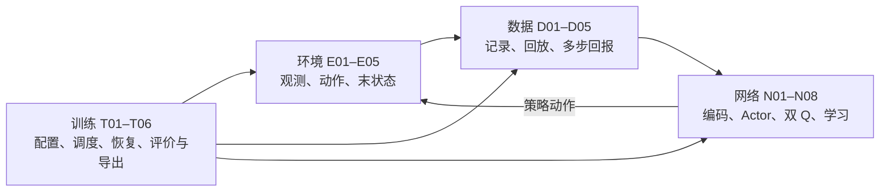

# study：从 TITA PPO 到 SAC｜人类阅读版

[项目入口与公共约定](README.md) · [环境与动作接口](environment_control/README_HUMAN.md) · [经验与回报](experience_returns/README_HUMAN.md) · [网络与学习](networks_learning/README_HUMAN.md) · [训练与验证](training_validation/README_HUMAN.md)

| 字段 | 当前内容 |
|---|---|
| 文档状态 | 讲解与技术复核已完成，本轮不再润色；小模块与大模块完成后编写本概览，每目录保留一份人类版 |
| 技术核对状态 | 2026-10-31，Codex 基于实际实现、测试与既有技术说明核对总数据流、模块边界、接入变化与验证范围；不是全面代码审核 |
| 语言润色状态 | 本轮由 Codex 完成中文讲解与技术核对，不再交 Gemini |
| 已核对代码版本 | 原实现 main `f6c8b03d`；Windows 路径修复 `373bb48d`；诊断及证据提交 `aa0c2a549dd3b2da61e79d8d1988e019ec25ed37`（PR #9 已合并），未改算法 |
| 待同步代码版本 | 无 |
| 实际阅读材料 | AGENTS.md、CODEX.md、根/大模块/目标小模块 AI README、实现/注释/测试与必要依赖；详见文末 |
| 验证依据与限制 | 2026-10-31 Windows 真实平地 1 环境的加载、50/1005 步交互、短训练保存恢复及提前计数纯截断通过；历史 CPU 记录保留，本轮不重跑全仓。截断仅实际推进 0.04 s，不证明稳定运行 20 s；复杂地形、长期训练、性能与稳定行走未验证。证据见下方 Windows 验证记录 |

## Windows 验证记录（2026-10-31）

该次 Windows 平地单环境最小闭环与提前计数纯时间截断检查已通过，证据随 PR #9 合并入库；该次检查未覆盖复杂地形、长期训练、性能或稳定行走。后续实验进展见[项目当前状态](README.md#当前状态)。[精简报告、命令与 JSON 证据](environment_control/robot_environment/validation/windows_2026-10-31/REPORT.md)。

提前计数截断仅实际推进 0.04 秒，不证明稳定运行满 20 秒。T06 入口本身未执行仿真，simulation/performance 仍为 not_run；详细计数、命令、告警和数据边界见上述证据。

## 项目要完成什么

本文解释整体数据流；希望复查成果时，从[首页验证步骤](README.md#运行与检查)开始，分别检查 CPU 流程、真实仿真和训练表现。准备修改代码的人或 AI 共用[项目维护规则](README.md#项目维护规则)：修改小模块必须在同次改动中同步该模块的接口规范与人类讲解，不再分配给不同代理等待交接。

TITA 是同时用腿部关节角和轮子转速控制的轮腿机器人。本项目把其运动学习主线从 PPO（Proximal Policy Optimization，近端策略优化）迁移到 SAC（Soft Actor-Critic，软演员—评论家算法），保留原 PPO 作为固定对照，并尽量保持机器人、执行器、任务指令和奖励可比较。

策略是由观测选择动作的规则，Actor 是实现策略的神经网络；回报是未来奖励的折扣累计，Q 网络估计某状态执行指定动作后的回报；经验回放把旧交互保存下来，供学习反复使用。SAC 还用熵（动作分布多样性的度量）与温度 alpha 调节探索，目标不是让动作越激烈越好。

当前 24 个小模块都有实现和相应 CPU 测试。下文技术讲解与证据表对应 2026-10-31 的代码核对记录；后续 Windows 实验进展集中见[项目当前状态](README.md#当前状态)，不重复写入各份讲解。CPU 人工数据、真实仿真运行与学会行走是不同层级的证据。

## PPO → SAC 改了哪些事情

| 方面 | 固定 PPO 路径 | 本项目 SAC 路径 |
|---|---|---|
| 经历使用 | 收集近期批次，计算优势后更新 | 长期保存原始经历，按合法连续起点反复抽样 |
| 价值学习 | V(s) 评价状态，使用优势/GAE（广义优势估计） | 两个 Q(s,a) 评价指定动作，用多步真实奖励与目标 Q 构造学习目标 |
| 策略更新 | 使用新旧策略概率比及裁剪等 PPO 目标 | 用当前 Q 和动作对数密度更新 Actor，单独学习温度 alpha |
| 动作分布 | 原高斯策略 | 高斯重参数化采样后经 tanh 压缩，再映射到 E04 各维边界，密度包含完整变换修正 |
| 超时处理 | 采集时给奖励预加旧价值补偿 | 保存原始奖励与重置前末状态，回放时重新估值，真终止优先 |
| 输入与辅助学习 | 历史编码、速度监督、Barlow Twins | 保留相同主要功能，但统计更新与使用分开，编码器按独立辅助频率学习 |

Barlow Twins 是让相邻历史窗口的对应特征一致、不同特征减少冗余的辅助目标；它帮助训练历史编码器，不能替代 SAC 的策略和价值目标。多步回报 n=5、γ=0.97 等是论文候选实验起点，尚未证明是 TITA 最优设置。

论文及作者实现强调动作边界、温和初始化、正确截断和多步回报；混合位置/轮速、10 帧历史、独立辅助更新与真实环境接口属于本项目适配。原框架名为 NP3O，当前 TITA 未启用实际 cost 约束项，运动学习主线按 PPO 加辅助学习理解。

## 四大模块怎样组成闭环



E 模块负责物理含义和时间线；D 模块保证旧经历可重复读取且不跨回合拼接；N 模块负责各网络的计算与更新；T 模块决定调用顺序、频率，并组织可复查证据。四个目录下的小模块平级，实现、测试、AI 契约与人类版放在同目录。

以下 24 个入口可按问题查阅，不需要一次读完所有函数：

| 编号与人类版 | 在数据流中的工作 |
|---|---|
| [E01 机器人与任务环境](environment_control/robot_environment/README_HUMAN.md) | 锁定资产，继承并创建任务，核对运行时元数据，提供真实接入入口 |
| [E02 观测接口](environment_control/observation_interface/README_HUMAN.md) | 明确 Actor/Q 字段、列区间、缩放，维护策略历史 |
| [E03 八维动作定义表](environment_control/action_contract/README_HUMAN.md) | 索引对应关节、控制类型、默认目标、scale 与 clip |
| [E04 动作边界与初始中心](environment_control/action_bounds/README_HUMAN.md) | 物理范围反推策略边界，校准初始确定性目标 |
| [E05 生命周期](environment_control/episode_lifecycle/README_HUMAN.md) | 真终止/截断、重置前末状态、交互观测、历史和编号 |
| [D01 经历记录契约](experience_returns/transition_schema/README_HUMAN.md) | 一次动作前后的统一字段与复制责任 |
| [D02 经验池](experience_returns/replay_buffer/README_HUMAN.md) | 按环境存储、环形覆盖、连续性抽样与池状态保存 |
| [D03 多步回报](experience_returns/n_step_returns/README_HUMAN.md) | 累计到 n 步或结束，选正确尾部与自举开关 |
| [D04 归一化](experience_returns/normalization/README_HUMAN.md) | 新数据更新统计，回放与推理只用统计 |
| [D05 历史窗口](experience_returns/history_windows/README_HUMAN.md) | 切 t−4…t 与 t−5…t−1，检查有效历史 |
| [N01 历史编码](networks_learning/history_encoder/README_HUMAN.md) | 最近五帧编码并组装 52 维 Actor 特征 |
| [N02 辅助学习](networks_learning/auxiliary_learning/README_HUMAN.md) | 速度监督与 Barlow Twins，单独更新编码器/projector |
| [N03 动作分布](networks_learning/actor_distribution/README_HUMAN.md) | 有界随机动作、确定性动作和正确 log π |
| [N04 双 Q](networks_learning/q_networks/README_HUMAN.md) | 两套独立 Q 及完整目标副本 |
| [N05 Critic 学习](networks_learning/critic_learning/README_HUMAN.md) | 多步目标、尾状态新动作、在线双 Q 更新 |
| [N06 Actor 学习](networks_learning/actor_learning/README_HUMAN.md) | 用 Q 反馈和熵项改进当前策略，隔离 Q/编码器参数 |
| [N07 温度](networks_learning/entropy_temperature/README_HUMAN.md) | 调整 log_alpha，明确目标熵坐标 |
| [N08 目标更新](networks_learning/target_updates/README_HUMAN.md) | 目标参数慢跟随、缓冲直接复制 |
| [T01 配置](training_validation/configuration/README_HUMAN.md) | 逐字段来源、规模、设备、版本、内存估算 |
| [T02 调度](training_validation/training_loop/README_HUMAN.md) | 采集→回放→学习的顺序、频率和计数 |
| [T03 检查点](training_validation/checkpoints/README_HUMAN.md) | 保存完整学习状态，明确两种恢复与环境重启 |
| [T04 评价](training_validation/evaluation/README_HUMAN.md) | 指标口径、不同训练种子、可比预算与结论门槛 |
| [T05 导出](training_validation/export_inference/README_HUMAN.md) | 冻结归一化/历史编码/Actor，输出策略动作 |
| [T06 检查](training_validation/verification/README_HUMAN.md) | 文档、单元、CPU 集成、仿真和性能五层证据 |

## 跟踪一次动作前后发生的事

B 是并行环境数，C 是 Q 状态信息维数。当前观测历史 `[B,10,33]` 含当前帧、从旧到新；E02 的帧字段已经做环境 scale，D04 再用统计归一化。D05 最近五帧按帧顺序展平为 165 维，N01 输出速度估计 3 维和隐藏特征 16 维，与当前帧 33 维拼成 52 维 Actor 输入。

Q 的信息比 Actor 多：平地 `[critic36|priv18]` 为 C=54，复杂地形再加 scanner187 为 C=241。真实身体线速度只给 Q 和辅助监督，标签乘过 2.0，除以 2 才是 m/s。接触/执行器增益和扫描也不直接给 Actor。C 和字段顺序必须在运行时核对，不能静默截断或补齐。

N03 输出 `[B,8]` 策略动作。E03 顺序是先左侧三个腿关节加轮，再右侧三个腿关节加轮；位置索引 0/1/2/4/5/6，轮速索引 3/7。例如 a=0.4，左腿第 1 关节目标 `0.1+0.25×0.4=0.2 rad`，左轮目标 `5×0.4=2 rad/s`。物理换算由 Isaac 动作项执行一次，Q 和经验池保存的仍是策略动作，导出模型也输出这个坐标。

E01 每个策略周期推进 4 个物理步，即 4×0.005=0.02 s。E05 在 reset 前取得末状态快照，结束后返回新回合交互观测；T02 用旧编号和末状态建立 D01，随后 D04 统计新状态、D02 存原始经历。episode_id 和 step_index 决定连续性，数组相邻并不能证明时间相邻。

正常、真终止、纯时间截断对应的未来价值开关是 1、0、1。两种结束都会停止旧回合奖励累计；纯截断仍在旧回合末状态估值，不能接重置后的新回合起点。D01 的长度检查只是部分一致性检查，末状态正确捕获由 E05/E01 负责。

## 回放怎样改进策略

D02 抽合法片段，D03 构造 `R、k、γ^k、mask` 和尾状态。N05 用当前 Actor 在尾状态重新采样动作、目标双 Q 取较小值构造目标，只更新在线 Q。旧记录动作用于评价旧动作，不代替当前策略的尾部选择。

随后在起点状态**采样一次**：N07 先更新 alpha，N06 用新 alpha 和同次动作/密度更新 Actor。温度损失隔离 Actor 梯度；Actor 损失冻结 Q 参数但保留动作方向梯度；编码器只由 N02 辅助学习更新。N08 对目标参数慢更新，缓冲直接复制。

T02 控制频率：默认 Actor 在第 1、3、5…次 Critic 更新后更新，alpha 与目标 Q 默认每次，辅助学习按迭代计频。候选值由 T01 显式传入，不能用某个底层函数的默认值代替当前运行记录。

## 真实环境、设备与恢复到哪一步

资产已锁定为 ddt_ros2_control `e7b32d9746df900680641ff2845ffb0b5ffe99ed`，URDF 摘要见 [UPSTREAM.json](UPSTREAM.json)。固定版本和文件校验解决可追踪性；真实运行的进展见[项目当前状态](README.md#当前状态)，本节说明实现约定。

E01 `run_sac_isaac.py` 提供 `inspect/interact/train`：先核对资产、动作、周期、观测和配置差异，再交互或填 T01 配置训练；train 还保存、构造新 Trainer、恢复并续一轮。它复用原任务，只关闭 Isaac 内部 policy 历史，由 E02 保持 10 帧，E05 避免重复推进。

学习器 `RunConfig.device` 目前强制 cpu；E01 `--device` 是仿真设备，另存 `environment.sim_device`。E05 每步将动作送到仿真设备，并逐张量将两份观测、奖励和标记搬回 CPU。没有 GPU 学习器实现，也没有搬运耗时或大规模吞吐证据。

工作轮速必须显式给定。约 13.87 rad/s 是默认姿态与最大指令的无滑动需求下限，30 rad/s 是模型上限参考；20 rad/s 只是建议的首次仿真调试值，不是代码默认或已验证参数。16 环境、8 步/轮、每环境容量 200、3 轮也只是接入调试规模。操作顺序与命令见 [E01](environment_control/robot_environment/README_HUMAN.md)，本次执行的平地单环境命令与证据见 Windows 验证记录，复杂地形未执行。

T03 的带池 `exact_replay` 恢复学习状态、统计、计数、随机流和经验池，已在同配置 CPU 条件下验证回放学习接续；不带池 `model_only` 仍恢复其他学习状态，只是池为空，要重新采集。两者都不保存环境现场，恢复后新轮次编号避免 D02 接错回合，不能承诺原物理轨迹不间断继续。

## 建议的阅读与排错顺序

学习概念时按 E03→E04→E02→E05→D01→D02→D03→D04/D05→N01～N08→T01/T02；准备运行时先看 E01→T01→T02→T03，再看 T05/T04/T06。各大模块概览解释衔接，小模块说明再定位具体函数。

| 问题 | 优先入口 |
|---|---|
| 模型加载、资产摘要或依赖错误 | E01；先核对固定版本和路径 |
| 形状正确但动作异常 | E02 字段/缩放、E03 两种关节顺序、是否重复物理换算 |
| 每逢 reset 回报跳变 | E05 末状态来源、D01 标记、D03 尾部、N05 目标 |
| 历史出现重复当前帧 | E01 关闭 Isaac 历史、E02 推帧、E05 选择、D05 切片、T05 导出 |
| 恢复后抽样或输入变了 | T03 的配置/随机流、D02 序号、D04 与 BN 统计 |
| 学习跳过或频率异常 | T02 计数与预热、D02 合法起点、N02 有效历史 |
| 报告不判定 SAC 更优 | T04 信号、不同种子、预算和固定阈值；当前没有真实对照结果 |
| “检查通过”是否意味着训练成功 | T06 分层结果与未执行项 |

## 阅读材料与验证依据

以下保留 2026-10-31 人类版编写时的核对记录，不代表后续实验的当前状态。

当时在独立 worktree 阅读实际提交及其与 main 的差异，读 AGENTS.md、CODEX.md、根和四大模块 AI README、五个环境模块及 T01/T02/T06 的相关 AI 契约/交接。重点通读 E01 的四个实现文件与测试、E02/E05 实现与测试；对照 E03/E04 未变实现及测试、T01 配置/测试、T02 runner/fake_env 与测试调用、T03 checkpoint、T06 verify/test_verify 和新增集成测试。

D/N 的概览使用既有按实际代码核对的人类版与 AI 契约，必要 D01/D03/D04/D05 实现及网络调用关系另作对照；本分支未修改这些算法，本轮没有扩大为重新审计全部 D/N。固定 PPO 快照与官方 Isaac Lab v2.3.0 的阅读片段见[环境大模块材料](environment_control/README_HUMAN.md#阅读材料与验证依据)。作者 SAC/论文来源沿用固定版本记录，本轮未重新复现论文或验证训练效果。

| 证据 | 来源和准确含义 |
|---|---|
| 代码已实现 | 当前 24 个小模块都有实际实现/测试；Isaac 入口能阅读，不等于已执行 |
| E 模块既有 CPU 结果 | AI 交接表记录 E01/E02/E03/E04/E05 为 14/8/18/14/10 项；E01 未设 TITA_URDF 时跳过真实文件项，另一次设置后通过 |
| 全仓库既有 CPU 结果 | PR #8 记录 Python 3.11.17 + torch 2.15.0、2.7.0 CPU 的 24 个测试文件回归；verify unit 共 216 项，其中 1 项跳过，其余通过。不是 216 项都执行了真实资产检查 |
| 更新后 CPU 集成 | `794cd62` 后 T06 共 10 项检查选择，展开 18 个测试，通过、跳过 0；新增 E01/E05 两项使用人工钩子 |
| 本轮实际文档检查 | 在独立 worktree 用 Python 3.14.5 标准库运行 `python3 -B training_validation/verification/verify.py --docs`：documentation passed，其余四层 not_run，退出码 0；11 份目标人类版的 156 处本地链接/锚点、157 个实现类/函数名称、25 段真实 Python 片段均已静态对照，单位、状态及 `git diff --check` 通过；未运行算法测试 |
| Isaac / GPU / 训练效果 / 性能 | 未验证；没有真实机器人行走成功或 SAC 优于 PPO 的结论 |

文档检查命令在仓库根目录运行：

```bash
python3 -B training_validation/verification/verify.py --docs
```

T06 将文档、单元、CPU 集成、仿真、性能分开报告；`--docs` 通过时，其余层本次均未执行。文档链接存在不证明公式或算法正确，CPU 人工钩子通过也不证明真实 Isaac 或训练成功。评价还需要至少三个不同有效训练种子、固定任务/预算与提前确定的阈值；耗时 5% 容差是项目暂定约定，不是论文结论。

本轮未发现新增实质代码问题。保留一处已确认文字残留：[config.py](training_validation/configuration/config.py) 文件头仍写资产“尚未锁定”，与同文件 `TARGET_ENVIRONMENT` 和 UPSTREAM.json 的已锁定提交相矛盾；人类版按实际常量同步，未修改源码。真实环境执行、GPU 搬运成本、轮速余量、训练效果及性能是后续验证工作。
