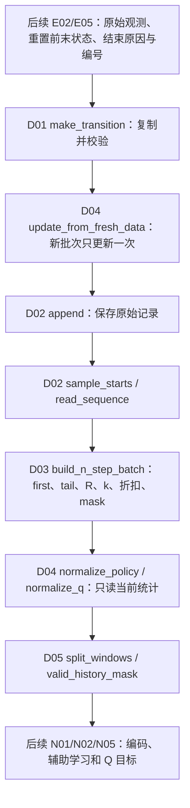

# 经验与回报｜人类阅读版

[AI 实施规范](README.md) · [项目人类版](../README_HUMAN.md) · [Codex](../CODEX.md) · [Gemini](../GEMINI.md)

| 字段 | 当前内容 |
|---|---|
| 文档状态 | 技术初稿完成，待 Gemini 润色 |
| 技术核对状态 | 已实际阅读 D01～D05 实现和测试，核对字段流向、时序、归一化与窗口配合；本页是概览，不替代各小模块接口说明 |
| 语言润色状态 | 待 Gemini 润色，尚未润色；D01 既有人类版保留 |
| 已核对代码版本 | 分支 `claude/experience-returns`，审核基准 `7071e41f27f0b5e56b9bed3ef3e796741f96ee40`，开始时本地与 PR #5 均为此提交，无新增提交；D05 文件头另有本次说明修正，不改执行语句 |
| 待同步代码版本 | 无 |
| 实际阅读材料 | 根 AGENTS/CODEX/README、本文 AI README、D01～D05 AI README、五个实现与五个测试文件，原人类版占位及 D01 导航/调用关系，UPSTREAM/GEMINI；固定 PPO 存储/归一化/历史切片片段和 T05 契约，详见下方阅读材料表 |
| 验证依据与限制 | 用户报告五模块 55 项 CPU 检查已独立通过；[PR #5](https://github.com/kissmvp8-afk/study/pull/5) 与各 AI README 保存原命令及结果。本文编写只做文档和注释静态核对，没有重跑算法测试、仿真或训练 |

## 这一层负责把交互事实变成训练输入

机器人执行动作后，训练不仅需要“得分多少”，还需要知道数据来自哪个环境、哪一轮、哪一时刻，以及动作后真正到达哪里。本大模块把这些事实保存下来，按正确顺序抽取连续经历，构造多步奖励，并准备一致的观测尺度和历史窗口。

这里假定读者已有 Python 基础。强化学习中，Actor 产生动作，Q 评价状态与动作；经验回放保存过去数据供重复学习，SAC（Soft Actor-Critic，软演员—评论家算法）是后续要接入的训练算法。D01～D05 已完成的是张量与纯数据逻辑，**没有网络更新、仿真接入或可运行的 SAC 训练循环**。

## 五个平级模块怎样分工

| 模块与人类版 | 解决的问题 | 当前证据与阅读状态 |
|---|---|---|
| [D01 经历记录契约](transition_schema/README_HUMAN.md) | 一次动作前后保存哪些原始字段，谁负责复制，如何推导终止开关 | 20 项 CPU 检查；既有讲解与润色完成，本次只同步过时衔接文字 |
| [D02 经验池写入与抽样](replay_buffer/README_HUMAN.md) | 容量覆盖、多环境交错时如何保存和抽取连续片段 | 9 项 CPU 检查；技术初稿完成，待 Gemini 润色 |
| [D03 连续多步回报](n_step_returns/README_HUMAN.md) | 累计到哪里、实际用了几步、末状态选哪一条 | 7 项 CPU 检查；技术初稿完成，待 Gemini 润色 |
| [D04 观测归一化与统计管理](normalization/README_HUMAN.md) | 哪些真实状态统计一次，回放怎样只读使用同一尺度 | 8 项 CPU 检查；技术初稿完成，待 Gemini 润色 |
| [D05 历史窗口与有效性](history_windows/README_HUMAN.md) | 十帧历史怎样切成当前帧和相邻五帧窗口，何时可用于辅助学习 | 11 项 CPU 检查；技术初稿完成，待 Gemini 润色 |

建议沿 D01→D02→D03 理解存储和时间，再读 D04/D05 理解网络输入。各目录保留一份 `README_HUMAN.md`；Gemini 在原文件上润色，不另建版本。

## 两条调用路径：新采集更新，回放读取



这是接口规定的接入顺序，已有 CPU 测试覆盖部分模块衔接；E02/E05、实际采集循环与后续网络仍未实现。D04 的更新放在**新记录**路径，不放在经验池每次抽样的路径。池内始终保存原始观测，训练时用当前统计、当前编码器重新解释旧数据。

| 阶段 | 主要数据形状与时间含义 |
|---|---|
| D01 新记录 B 条 | 当前/真实下一策略历史 `[B,10,33]`，Q 状态信息 `[B,C]`，策略动作 `[B,8]`，奖励与结束标记 `[B,1]`，编号与有效长度 `[B]` |
| D02 抽 M 个起点、每个读 n 条 | 各字段变为 `[M,n,...]`，另有 `[M,n] valid`；n 是转移数，不是过去历史帧数 |
| D03 返回 | `first` 为起点记录，`tail` 为第 k-1 条记录，R/γ^k/mask 为 `[M,1]`，k 为 `[M]`；目标状态用 `tail.next_*` |
| D04/D05 准备网络输入 | 同一 33 维统计逐帧变换，窗口为 `[M,5,33]`，当前帧 `[M,33]`；辅助标记 `[M]` 由有效长度判断 |

C 必须由 E02 运行时校验，54/241 是平地/复杂地形预期，不应从测试默认小维数反推真实接口。策略动作保持送入环境的坐标，不能把它换成关节角或轮速目标再存入 Q；奖励保留环境原始值，不预加旧价值预测。

## 用两步结束例子串起 D01→D02→D03

取 D03 现有人工案例：n=5、γ=0.5，本轮第 2 次动作后结束，每步奖励为 1，下一轮奖励为 `1e6`。

1. D01 保存这两次动作前后的事实、轮次/步号、原始奖励、结束标记和重置前 `next_*`。正常步 mask=1，真终止为 0，纯时间截断为 1。
2. D02 认为起点已经合法到达边界，虽然不足五条，仍可用于 n=5。结束后换轮的记录不属于连续有效前缀，下一轮大奖励不能当作后继。
3. D03 得 k=2、R=`1+0.5×1=1.5`、discount=`0.5²=0.25`，tail 是本轮第二条记录；估值状态是它的 `next_*`，不是下一轮初始观测。
4. 真终止时不接尾部价值；纯截断时目标形式为 `1.5+0.25×V(重置前末状态)`。V 由未来 N05 计算，本模块不计算这个预测。

如果只有两条记录但**未结束**，不能自行把它当成 k=2 的短目标；应等待后继，D02 排除这种五步起点，D03 强行接收也会报错。结束边界与数据暂缺是两回事。

## D04、D05 怎么配合而不重复工作

D04 只从每条新记录的真实下一最新帧统计一次，另计每轮首条记录的当前最新帧。它不把十帧历史全展开重复计数。独立的 D04 人工例子执行 12 次动作，统计的是真实帧 0..12 共 13 个样本，均值 6、方差 14；这些帧号不是上述两步奖励例子的实测观测。

回放时，D04 使用两套统计：policy 为逐帧 33 维，Q 为 C 维。online Q 与 target Q 共用相同 Q 变换，统计随检查点保存。更新对象不会自动识别重复数据，采集循环必须保证 update 每批只调用一次。

D05 不追加当前帧，直接切出 t、t-4..t、t-5..t-1。两窗口各五帧、联合六个时刻，辅助学习需要有效历史长度≥6；长度不足的标记不等于 bootstrap mask=0。当前窗口用 `first.history_length`，尾部下一窗口用 `tail.next_history_length`。D04 是逐帧固定变换，因此在同一统计下先切片或先归一化等价。

三种有效性各有用途，不能互换：D02 `valid` 判断转移连续且未被覆盖，D05 mask 判断历史是否足够真实帧，D01 bootstrap mask 判断能否接未来估值。它们都不能单独证明 E05 正确捕获了重置前末状态。

## 与原 PPO、作者 SAC 的关系

| 内容 | 原 PPO / 参考作者做法 | 本项目实际适配 |
|---|---|---|
| 保存经历 | PPO 近期 rollout 计算 GAE 后重置写入位置；作者 SAC 用回放 | D01 原始记录与 D02 长期环形存储，保留完整编码前历史 |
| 多环境连续性 | 本地作者来源说明记录了全局写指针、同步环境假设 | 逐环境写指针、覆盖序号、环境/轮次/步号联合判断 |
| 多步目标 | PPO 的优势估计与 SAC n 步 Q 目标用途不同；作者在首结束后屏蔽奖励 | D03 复用首结束思路，显式检查有效前缀，真终止优先，纯截断接重置前估值 |
| 输入统计 | 原 PPO training forward 自动更新；作者环境步更新有其末状态选择方式 | D04 更新/使用拆分，末状态与重置后初始状态各计一次 |
| 历史窗口 | 原 PPO 训练有相邻五帧窗口；其导出包装器对完整历史重复当前帧 | D05 与训练切片一致，记录导出问题，留 T05 处理；尚无新导出验证 |

作者 SAC 固定版本为 `e0d243aa6d3f8a7231783b7f3cefeaec1b4a5521`。本次实际阅读本项目与固定 PPO 片段，作者做法的描述依据本地源码说明及 AI 契约，未独立重读外部作者源码或论文。TITA 的历史、计数和编号方案属于本项目适配，人工测试通过不代表作者或本项目已经验证其训练收益。

## 阅读材料与证据

| 模块 | 实际读取的实现与测试 | 代码来源 |
|---|---|---|
| D01 | [schema.py](transition_schema/schema.py)、[test_schema.py](transition_schema/test_schema.py) | `7fe7e93`，本次不改 |
| D02 | [buffer.py](replay_buffer/buffer.py)、[test_buffer.py](replay_buffer/test_buffer.py) | `3838fe4` |
| D03 | [returns.py](n_step_returns/returns.py)、[test_returns.py](n_step_returns/test_returns.py) | `c3b2fe0` |
| D04 | [normalization.py](normalization/normalization.py)、[test_normalization.py](normalization/test_normalization.py) | `e77bc66` |
| D05 | [history.py](history_windows/history.py)、[test_history.py](history_windows/test_history.py) | `807ee63`；本次只修模块说明 |

另读了[根规范](../README.md)、[AGENTS](../AGENTS.md)、[CODEX](../CODEX.md)、[上层 AI README](README.md)、D01～D05 各自 AI README、原人类版、[UPSTREAM](../UPSTREAM.json)、[GEMINI](../GEMINI.md) 和 [T05 契约](../training_validation/export_inference/README.md)。通过 `git show` 读固定 PPO 快照 `8fe40aa0ab3afdb8998cab1357f1f795d2cabc3c` 的 `rollout_storage.py`（存储及 GAE）、`normalizer.py`（全文）、`actor_critic.py`（归一化、训练切片和导出相关片段），没有启动 PPO 或仿真。

已有记录环境为 macOS Darwin 25.4.0、uv 临时 Python 3.11.17 + torch 2.15.0（CPU）：D01/D02/D03/D04/D05 分别 20/9/7/8/11 项，总计 55；用户另报告已独立通过。PR #5 保留了结果与 D02～D05 原输出，numpy 未安装警告被去除。D03 首次有一项因 float32 大奖励下容差过严失败，修正容差后通过，细节见 D03 人类版。

本次不重复执行这些检查，只核对文档、链接、形状、公式和注释改动。需要复现时，可把下面路径替换为各目录的真实测试文件；它是已有运行方式，不是本次运行记录：

```bash
uv run --no-project --python 3.11 --with torch==2.15.0 python -B experience_returns/replay_buffer/test_buffer.py -v
```

其余测试文件依次为 `transition_schema/test_schema.py`、`n_step_returns/test_returns.py`、`normalization/test_normalization.py`、`history_windows/test_history.py`。当前仓库统一依赖配置仍属 T01 待办。

## 排错和后续边界

| 现象 | 优先查看 |
|---|---|
| 回报混入新轮大奖励或片段跳跃 | D01 编号/结束标记、D02 覆盖序号与 valid、D03 k 与 tail |
| 新记录正确，保存后却被改写 | D01 复制时机、D02 写入/读出复制，以及调用方是否原地修改视图 |
| 同输入回放多次输出尺度漂移 | D04 是否被错误 update、两种 Q 是否共用统计 |
| 辅助学习出现填充或跨轮数据 | D05 有效长度来源、D02 有效前缀与 E05 填充/捕获时机 |
| 导出后窗口不同 | D05 对当前帧已包含的约定及 T05 导出重复问题 |

尚未验证：E05 的实际末状态捕获和编号/填充维护、E02 实际 C 值、网络/采集循环与检查点接入、GPU、大容量内存和抽样性能、模型导出一致性、仿真、训练及性能。现有跨模块测试属于人工 CPU 衔接，不宣称整个机器人系统完成集成验证。

交给 Gemini 的范围是本页和 D02～D05 共五份 `README_HUMAN.md`，只润色文字与排版；保留接口、形状、公式、时间顺序、数字和验证限制。D01 既有正文不重新润色，本次只同步必要导航/调用关系。实现变化后仍先由 Codex 技术同步。
