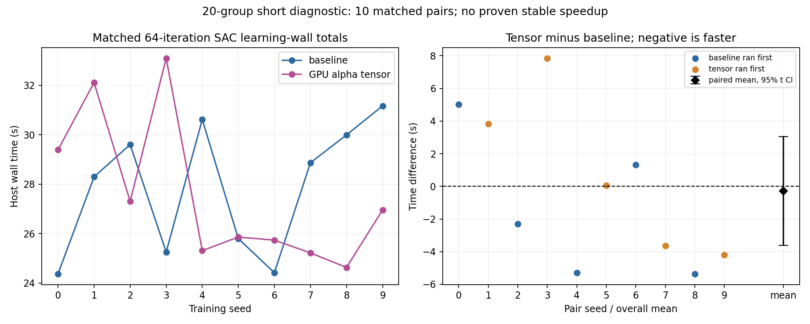

# 20组温度GPU张量诊断独立复审

本目录保存用户上传轻量证据的审阅及源码改动备份；原实验分支仍未由本审阅合并到正式算法。来源版本见[input-evidence.json](input-evidence.json)。

- [复审结论与边界](review.txt)
- [后续交接决定：保留原SAC-R3](next-step.txt) / [机器可读决定](decision.json)
- [核验统计](audit-summary.json)
- [20组配置与计时核对](groups.csv)
- [10对兼容性核对](paired-compatibility.csv) / [逐对耗时](paired-timings.csv)
- [配对统计与精确t区间](timing-statistics.json)
- [20次评价](evaluation-runs.csv) / [逐阶段复算](evaluation-stages.csv) / [指标差异](metric-discrepancies.json)
- [17份未提交源码改动及实验脚本备份](source-backup.zip) / [源码重构核验](source-backup-verification.json)



warmup实际为0，每组1024次Critic/alpha/target/auxiliary和512次Actor更新。10对训练及评价日志字节一致；权重未包含，只核对了模型哈希记录，没有验证模型本体。学习段平均差约-.277秒，95%区间跨0。每版0/10控制通过。

独立复算只读JSON/CSV，不加载模型或运行仿真。需要Python和NumPy：

```sh
python independent_review.py --evidence-root /path/to/extracted/light-evidence --output-dir /path/to/new-audit
```

原SAC-R3固定计划仍在[此前交接目录](https://github.com/kissmvp8-afk/study/tree/a1e0c51022b68be6ccff5684899db6110ff9ccf1/handoffs/training/reviews/sac-r2-20261108-6aa61581)。本轮不创建重复训练队列。用户已说明尚未转交Dot；执行与当前资源尚未确认。
