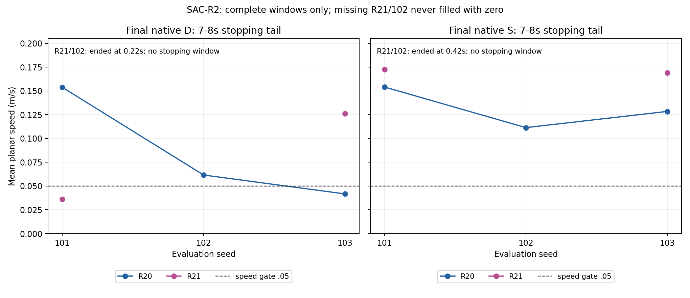
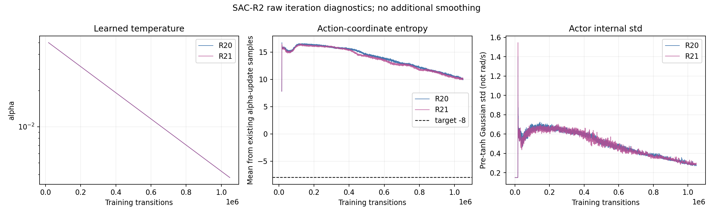

# SAC-R2独立复审与SAC-R3执行交接

输入为用户上传分卷重新拼接的三个原ZIP，输入原包及关键内容指纹见[input-evidence.json](input-evidence.json)。原训练结果尚未发布到仓库；本目录提交是审阅交接，不能冒充原训练结果提交。

- [独立复审、日志缺陷与下一轮依据](review.txt)
- [给Dot的SAC-R3完整执行指令](next-plan.txt)
- [参数、资源条件与推进门槛](parameters.json)
- [独立核验范围](audit-summary.json)
- [逐评价记录](independent-runs.csv) / [逐阶段指标](independent-stage-metrics.csv)
- [指标复算差异](metric-discrepancies.json) / [提前终止事件](failure-events.json)
- [训练窗口统计](training-windows.csv) / [训练日志语义核查](training-diagnostic-audit.json)
- [物理初态配对](paired-physical-starts.json) / [模型与恢复文件哈希核验](model-file-verification.json)





本轮复算46次评价、24,702个控制步和两臂16,384行CSV/JSONL训练记录。程序只读JSON/CSV，不载入模型、不执行附件脚本、不启动仿真。需要Python和NumPy；复现命令：

```sh
python independent_review.py --evidence-root /path/to/extracted/results/tita-sac/2026-11-08-sac-r2-rtx4090-seed0 --output-dir /path/to/new-audit
```

ZIP及模型文件的SHA/CRC核对另外记录在input-evidence.json和model-file-verification.json中，不能把数值复算脚本的通过解释为GPU或权重推理重现。

SAC-R3是从同一R20完整带池父检查点进行的两路短续训。只比较当前alpha原值/乘0.1，保留学习到的std、其他参数与原生S评价。先修正分项终止日志，逐轮核对其与真实当步终止计数一致。

本计划尚未由主审阅窗口启动。旧记录的租期截止已过，Dot必须先确认用户已授权的现有计算资源及到期时刻；无可用资源就回传blocked状态，不自动购买或续租。本聊天/定时任务的模型设置不改动。
