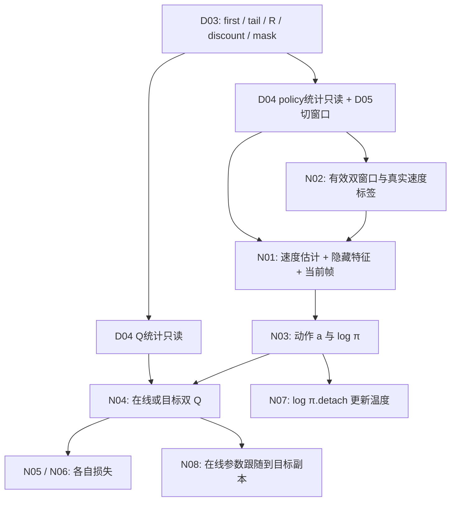

# 网络与学习｜人类阅读版

[AI 实施规范](README.md) · [项目人类版](../README_HUMAN.md) · [Codex 写作约定](../CODEX.md)

| 字段 | 当前内容 |
|---|---|
| 文档状态 | 讲解与技术复核已完成 |
| 技术核对状态 | 2026-10-31，Codex 在八份小模块人类版完成后核对概览，检查数据流、更新顺序、参数/统计归属、形状与链接；本轮不扩大代码审核范围 |
| 语言润色状态 | 本轮不再另交 Gemini |
| 已核对代码版本 | PR #6 分支 `claude/networks-learning` 的 `42c07a025f16fe41251c3e306a18313ce1704f02`，与用户已复核版本一致，无新增差异 |
| 待同步代码版本 | 无 |
| 实际阅读材料 | 根 AGENTS.md、CODEX.md、README.md、UPSTREAM.json；本大模块及 N01～N08 AI README、原人类版占位；八个实现与八个测试全文；E03/E04、D01～D05 必要契约及实现片段，E02/E05/T02 契约；固定 PPO 编码/窗口/辅助损失及优化相关片段，详见末尾阅读记录 |
| 验证依据与限制 | 用户报告前一轮 43 项 CPU 测试通过，修正后 N02/N06/N08 共17项再次通过；PR #6 与各 AI 交接表保存既有证据。本次只做文档静态检查，不重新运行算法测试。全部既有用例使用人工数据，未验证仿真、GPU 或真实训练效果 |

## 这一层怎样把经历变成更好的动作策略

读者已有 Python 基础，本页重点是模块间如何传递数据、谁更新哪些状态。Actor 是从观测生成动作的策略网络；Q 预测“状态与指定动作”对应的长期收益。SAC（Soft Actor-Critic，软演员—评论家算法）通过经验回放反复学习旧经历，同时用熵项保留动作多样性。

“网络与学习”接在 D01～D05 之后：原始经历已保存、连续片段已选好、多步奖励已累计，这一层负责解释历史、生成有界动作、构造 Q 目标并分别更新参数。它不负责推进机器人仿真、捕获重置前观测，也没有实现正式训练调度器。

N01～N08 已有可执行的 CPU 网络和更新函数，测试也包含反向传播；“尚未训练验证”指未接入仿真与正式训练循环、没有运动效果结论，并不表示这里全是空壳或只算静态公式。

## 八个平级模块与建议阅读顺序

| 模块 | 读完应掌握什么 | 既有 CPU 检查 |
|---|---|---:|
| [N01 历史状态编码](history_encoder/README_HUMAN.md) | 最近五帧如何按帧展平，输出速度3维、隐藏16维，再拼当前33维形成 Actor 的52维输入 | 7 |
| [N02 速度监督与 Barlow Twins](auxiliary_learning/README_HUMAN.md) | 编码器如何用速度标签和双窗口相关性学习，何时更新 BN、为何至少六帧且至少两条有效样本 | 8 |
| [N03 SAC 动作分布](actor_distribution/README_HUMAN.md) | 高斯采样经 tanh 与 E04 缩放后得到八维动作，密度与初始中心如何同步处理 | 7 |
| [N04 双 Q 评分网络](q_networks/README_HUMAN.md) | 两个在线 Q 如何评价同状态动作，目标副本如何独立复制，训练侧信息如何隔离 | 5 |
| [N05 Q 的训练目标与更新](critic_learning/README_HUMAN.md) | D03 的 R、γ^k、mask 怎样接目标软价值，旧动作与尾部新动作分别做什么 | 3 |
| [N06 Actor 参数更新](actor_learning/README_HUMAN.md) | 冻结 Q 参数而保留动作梯度，如何复用同一次采样和新 alpha 更新 Actor | 4 |
| [N07 探索力度 alpha](entropy_temperature/README_HUMAN.md) | 温度只学 log_alpha，目标熵为何必须对应动作密度的坐标 | 4 |
| [N08 目标 Q 慢更新](target_updates/README_HUMAN.md) | 参数插值、缓冲复制和调度频率，以及一次人工数据更新如何串联全模块 | 5 |

先读 N01/N02 理解表示学习，再沿 E03/E04→N03 理解动作坐标；接着读 N04→N05→N08 理解 Q 学习，最后把 N07 与 N06 合起来读。N08 的更新衔接测试可作为调用索引，具体函数、公式和测试细节留在对应小模块。

## 数据有两条主要去向

一条路径给 Actor：`policy_history[B,10,33] → 归一化 → recent[B,5,33] → 编码 → [预测速度3 | 隐藏16 | 当前33] → features[B,52] → action[B,8]、log_prob[B,1]`。另一条给 Q：`q_observation[B,C] → normalize_q → 与策略动作拼接 → 两个[B,1]评分`。

Q 可含 Actor 没有的训练侧信息，例如仿真真实身体线速度；真实速度只给 Q/辅助监督，Actor 使用自己的速度预测。C=54/241 只是预期，须由 E02 实际配置确认。Q 第一版未另设地形编码器，不能把原 PPO 的 scan_encoder 误写成已经迁移。

经验池保留原始观测和实际策略动作，不存随训练改变的隐藏表示。每次回放用当前 D04 统计和当前编码器重算特征；这里“原始”指未经 D04 再归一化，观测仍保留 E02 已规定的缩放。

## 一次更新的顺序与时间位置

| 次序 | 读取什么、做什么 | 输出/变化 |
|---|---|---|
| 1. Critic | N05 用 `tail.next_*` 经当前 Actor **重新采样尾部动作**，目标双 Q 给软价值；再用 `first.action` 训练在线 Q | 冻结 y，只改在线双 Q |
| 2. 当前状态采样 | N01 从 first 生成隔离特征，N03 采样一次 action/log_prob | 保留 Actor 计算图，不改模型参数/缓冲 |
| 3. 温度 | N07 使用这次 log_prob 的 detach 版本 | 只改 log_alpha，得到新 alpha |
| 4. Actor | N06 复用第2步 action/log_prob，配第3步**新 alpha**，评价在线 Q | 只改 Actor |
| 5. 目标跟随 | N08 对目标参数插值、缓冲直接复制 | 只改目标双 Q |
| 6. 辅助学习 | N02 用有效的双窗口及当前真实速度标签 | 只改编码器、projector 及其 BN 状态 |

尾部采样与当前状态采样用途不同：前者位于冻结 Q 目标中，不带梯度；后者用于温度与 Actor 两步，必须保留 Actor 图并共享同一次采样。所谓“只采样一次”约束的是后两步之间的复用，并不是整次学习只允许调用一次随机采样。

真终止时 N05 直接取 y=R，不计算尾部网络；纯时间截断仍接重置前末状态的软价值，但两种结束都不累计下一轮奖励。D03 的 k 是向未来累计的动作数，D05 的五帧是向过去看的观测，两者不是同一个时间窗口。

这张表来自 N08 的一次更新衔接。Actor 是否每两次 Critic 更新一次、每次采集做多少回放、辅助学习多频繁、n取1还是5，均由后续 T02 决定；当前没有正式调度器，不能把测试里每项执行一次直接复制成训练频率结论。

## 参数、梯度和三种统计状态

| 操作 | 本次学习/写入的状态 | 隔离边界 |
|---|---|---|
| N05 Q 损失 | 在线 Q1、Q2 与其优化器 | 目标计算 no_grad，不反传到 Actor、目标 Q、编码器或温度 |
| N06 Actor 损失 | N03 Actor 与其优化器 | 在线 Q 参数冻结，但评分对动作的梯度保留；特征来自 N01 no_grad/eval，alpha为float |
| N07 温度损失 | log_alpha 与其优化器 | log_prob.detach，不反传 Actor |
| N08 跟随 | 目标 Q 参数及目标缓冲 | no_grad，不进优化器；在线值不变 |
| N02 辅助损失 | 编码器、projector 与其优化器，含 BN 运行统计 | 输入/标签detach；有效样本不足跳过；正常更新后恢复eval |

三类容易混淆的状态分别是：D04 保存原始观测的均值/方差/计数，只在新采集时更新；N01/N02 网络内部 BN 的运行统计，只在辅助学习 train 前向期间更新；N03 保存的 E04 `center/half_width` 是动作边界缓冲，不训练。no_grad 控制计算图，eval 控制 BN 模式，二者不能互相替代。

N08 的 tau=0 只保持目标**参数**不变，缓冲仍复制。当前双 Q 不含 BN，外部 D04 统计也不参与慢更新；若未来加带缓冲的 Q 子模块，应重新核对复制约定。目标 Q 必须复制独立存储、冻结参数且不进任何优化器。

## 与原 PPO、作者 SAC 和本项目适配的关系

| 部分 | 保留或参考 | 本项目的明确选择 |
|---|---|---|
| 历史/辅助学习 | 原 PPO 的五帧编码层序、3/16维头、BT与速度误差 | 辅助优化器与 SAC 更新分离，六帧/两样本筛选，BN 模式显式管理 |
| 动作 | 作者 SAC 的高斯重参数化、tanh及缩放思路；PPO 的512/256/128隐藏维数 | 每维按 E03/E04 区分位置/轮速，u0校准确定性中心、内部std=0.15，密度使用稳定恒等式 |
| Q/Actor/温度 | 作者固定版本的双 Q、软价值目标、Actor目标与温度损失 | 用 D03 多步奖励、真实末状态和 TITA 历史接口；采样→温度→新alpha与同次采样的Actor更新 |
| 目标/调度 | 作者tau=0.005、每Critic更新跟随一次作为起点 | 所有缓冲直接复制；正式 Actor/辅助频率仍待T02 |

N03 的 log π 包含高斯、tanh导数、半宽三部分。N07 保留**策略动作坐标**目标熵−8，单位区间 `y=tanh(u)` 下等价值为 `−8−Σlog(c)`；改变半宽而仍固定动作坐标−8，会改变单位区间的探索要求。这些超参数与坐标选择是可复现的起点，不代表已在 TITA 上验证合适。

## 排错入口与后续接入

| 现象 | 先查哪里 |
|---|---|
| 维数都对但 Actor 行为异常 | N01 展平/拼接顺序，D05 是否重复当前帧，D04 是否重复归一化 |
| 速度估计相差两倍 | N02 标签是否保留 E02 的2.0缩放、是否误拿归一化Q字段作标签 |
| BN 不该变却在变、辅助损失为NaN | N01 eval与no_grad；N02是否先筛≥6帧、有效样本是否至少2 |
| 动作总贴边、alpha异常 | N03 u0/std与三项密度、E04真实半宽；N07密度/目标熵坐标 |
| 终止附近Q异常 | D03的k、mask与tail.next_*，E05捕获时机；N05是否显式排除真终止 |
| Actor没有Q方向的梯度 | N06是否对整个Q前向用了no_grad或detach动作，是否用了新alpha与同次采样 |
| 目标不动或立即跟在线跳变 | N04存储独立性、N08 tau/计数/优化器归属及缓冲规则 |

E02 仍须确定 C 与速度标签位置；E04 仍需真实限位/工作轮速；E05 须正确捕获末状态和维护历史；T02 提供采集/更新频率，T03 保存网络、所有优化器和 D04 统计，T05 验证 N01+N03 确定性导出路径。这些是接入待办，不能写成当前已有仿真或训练功能。

## 阅读材料与验证边界

| 模块 | 实际阅读的实现与测试 | 实现来源 |
|---|---|---|
| N01 | [encoder.py](history_encoder/encoder.py)、[test_encoder.py](history_encoder/test_encoder.py) | `7e7d34a` |
| N02 | [auxiliary.py](auxiliary_learning/auxiliary.py)、[test_auxiliary.py](auxiliary_learning/test_auxiliary.py) | `2e6c470`，说明修正`bd69772` |
| N03 | [actor.py](actor_distribution/actor.py)、[test_actor.py](actor_distribution/test_actor.py) | `a7a469e` |
| N04 | [critics.py](q_networks/critics.py)、[test_critics.py](q_networks/test_critics.py) | `ef98631` |
| N05 | [critic_update.py](critic_learning/critic_update.py)、[test_critic_update.py](critic_learning/test_critic_update.py) | `e43b4ea` |
| N06 | [actor_update.py](actor_learning/actor_update.py)、[test_actor_update.py](actor_learning/test_actor_update.py) | `0b150dc`，接口修正`bd69772` |
| N07 | [temperature.py](entropy_temperature/temperature.py)、[test_temperature.py](entropy_temperature/test_temperature.py) | `b186639` |
| N08 | [targets.py](target_updates/targets.py)、[test_targets.py](target_updates/test_targets.py) | `7f671f3`，衔接修正`bd69772` |

以上文件均读取于 `42c07a025f16fe41251c3e306a18313ce1704f02`；`42c07a0` 同步了审核后文档，N02交接表残留的“最大损失”文字由本次按授权修正。

依赖实际阅读包括 E03 `contract.py` 动作结构/换算、E04 `bounds.py` 与测试人工范围/单维案例；D01记录/mask、D02写入/抽样/读取、D03多步批次、D04归一化/新样本选择、D05窗口与有效性接口的关键实现，以及相应AI契约。没有重写“经验与回报”人类版。

固定 PPO 快照为 `8fe40aa0ab3afdb8998cab1357f1f795d2cabc3c`：通过 `git show` 实际读了 `actor_critic.py` 的窗口、编码器构造/forward、BT损失与off_diagonal、Critic和扫描编码结构，`common_modules.py` 的MLP/BN工厂，以及 `np3o.py` 的损失/优化相关片段。作者 SAC 固定参考为 `e0d243aa6d3f8a7231783b7f3cefeaec1b4a5521`，相关差异依据本地注释与AI来源记录；本次未独立拉取外部作者源码或重新通读论文，不声称复现作者或 TITA 训练结果。

既有环境记录为 macOS Darwin 25.4.0、Python3.11.17、torch2.15.0（CPU）；各AI交接表保存命令、结果及历史调试记录。用户报告43项原测试通过，修正后17项再次通过。**本次写作未运行这些测试、仿真、GPU或正式训练**，只核对文档链接、函数覆盖、代码片段、数字、版本与修改范围。CPU人工更新衔接与机器人集成验证分别记录，不能互相替代。
